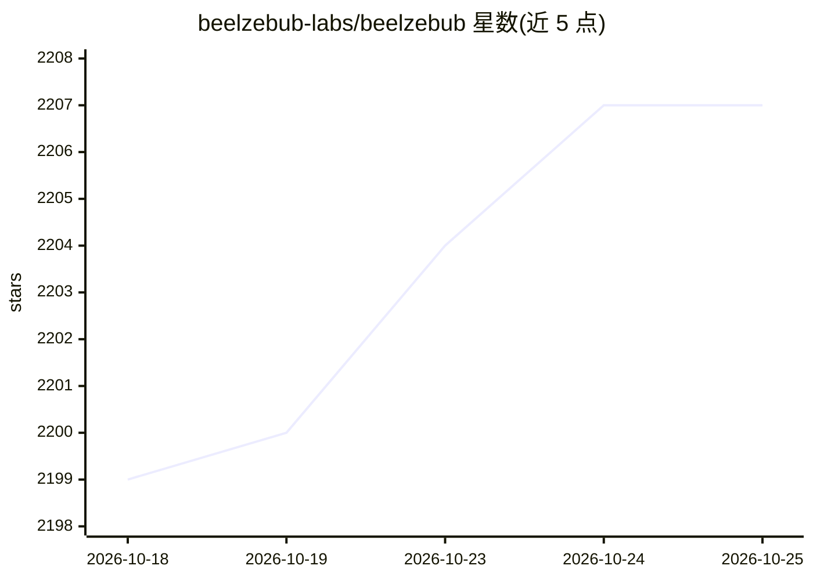

# beelzebub-labs/beelzebub

⭐ 2,212 · Go · GPL-3.0 · 推送 2026-10-24 · [GitHub](https://github.com/beelzebub-labs/beelzebub) · [官网](https://docs.beelzebub.ai) · 组织维护

**蜜罐欺骗框架：部署诱饵服务并采集攻击交互证据**

Go 编写的开源欺骗（蜜罐）运行时框架，面向安全团队。以 YAML 定义诱饵服务、路由与响应规则，支持 SSH、HTTP、TCP、TELNET、MCP 等协议；可用静态处理器或配置 LLM provider 后的 LLM 响应生成自适应交互，并可通过可信 Go 插件扩展运行时。采集的命令、HTTP 请求与会话上下文等证据可输出到日志、RabbitMQ、Prometheus 或可选的 Beelzebub Platform。部署方式包括本地 Go 二进制、Docker Compose 与 Kubernetes Helm；LLM 响应为可选，静态处理器无需 provider 即可运行。

## 筛选速览

| 维度 | 判定 | 备注 |
|---|---|---|
| AI 角色 | `ai-enhanced` | 去掉 AI 部分产品仍成立 |
| 许可风险 | `viral` | GPL-3.0 |
| 部署形态 | `self-host` | docker 或自建部署 |
| 模型依赖 | — | README 未给出锁定关系 |
| 硬件要求 | — | 无带数字的原话,不猜 |
| 安装摩擦 | `low` | 无编译、无系统依赖或容器化 |
| 成熟度 | — | 结构信号不足 |

## 能力要点

- YAML 定义诱饵服务与响应规则，含 18 个示例配置
- 支持 SSH/HTTP/TCP/TELNET/MCP 协议，MCP 诱饵暴露诱饵工具观测 agent 可疑调用
- 可选 LLM 生成自适应响应，静态处理器无需 provider
- 证据输出到日志/RabbitMQ/Prometheus，可用 Go 插件扩展运行时

## 适用场景

- 部署诱饵服务研究攻击者行为并留存证据
- 受控环境下测试 AI agent 的提示注入与可疑工具调用
- 将蜜罐事件接入 RabbitMQ/Prometheus 的安全监测流程

## 场景标签

`网络安全` · 领域:学习与行业

## 证据(README 行号)

> L21: - **Deploy decoys that fit your environment.** Define services, routes, and response rules in YAML. Use static hand
> L35: Define services and rules in YAML, validate the configuration, and start the runtime. Trusted Go plugins are compil

## 星数曲线

2026-10-18 2,199 → 2026-10-25 2,207（+8）

---
*卡片 v1 · prompt 1.4 · 生成 2026-10-21 · 置信度 high · 依据 README sha `4a04b9a9c9a3` · [字段定义](../../DATASET.md)*
