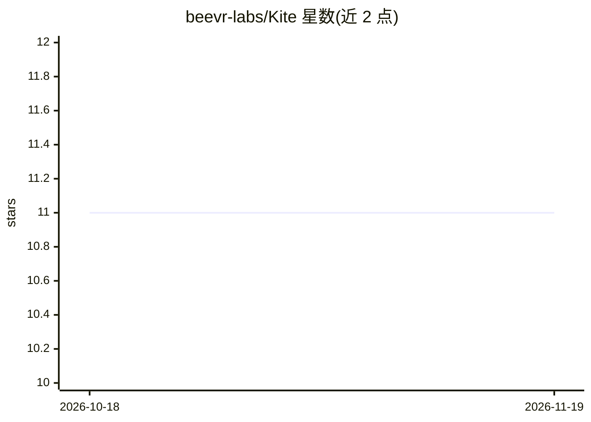

# beevr-labs/Kite

⭐ 11 · Python · MIT · 推送 2026-06-30 · [GitHub](https://github.com/beevr-labs/Kite) · [官网](https://beevr.ai/ai-development-company) · 组织维护

**开发者构建生产级 AI agent 的轻量 Python 框架**

Kite 是一个 Python agent 框架，通过 pip 安装、CLI 一条命令从自然语言生成可运行的多 agent 脚本或脚手架工程。核心机制是 LLM 只提出动作建议、Kernel 校验后才执行，并内置断路器、kill switch、命令白名单等安全组件；支持 ReAct/ReWOO/ToT/Plan-Execute/Reflective 五种推理模式、RAG 文档加载、Prompt A/B 测试、多 agent 对话、人审检查点与 JSON 追踪。通过环境变量切换 Groq/OpenAI/Anthropic/Ollama 后端。MIT 许可，需 Python 3.8+。

## 筛选速览

| 维度 | 判定 | 备注 |
|---|---|---|
| AI 角色 | `ai-ecosystem` | LLM/agent 周边工具 |
| 许可风险 | `permissive` | MIT |
| 部署形态 | `library` | 以包/库形式分发 |
| 模型依赖 | local-ok | 支持本地模型 |
| 硬件要求 | — | 无带数字的原话,不猜 |
| 安装摩擦 | `low` | 无编译、无系统依赖或容器化 |
| 成熟度 | — | 结构信号不足 |

## 能力要点

- LLM 提议、Kernel 验证后才执行，内置断路器与 kill switch
- 五种推理模式（ReAct/ReWOO/ToT/Plan-Execute/Reflective）
- CLI 一条命令生成多 agent 应用或脚手架工程
- 支持 RAG、Prompt A/B 测试与 JSON 事件追踪

## 适用场景

- 一条命令生成客服或研究助理类 agent 应用
- 限制 LLM 只能调用白名单命令的运维自动化
- 按任务复杂度在快/慢模型间路由以降低调用成本

## 场景标签

`Agent 框架` `多智能体` · 领域:Agent 开发

## 证据(README 行号)

> L13: pip install kite-agent
> L34: ## The core idea: LLMs don't execute. They propose.
> L89: agent = ai.create_agent(name="Bot", agent_type="react", ...)        # think→act→observe loop

## 星数曲线

2026-10-18 11 → 2026-11-19 11（+0）

---
*卡片 v1 · prompt 1.4 · 生成 2026-11-18 · 置信度 high · 依据 README sha `02f610671d37` · [字段定义](../../DATASET.md)*
