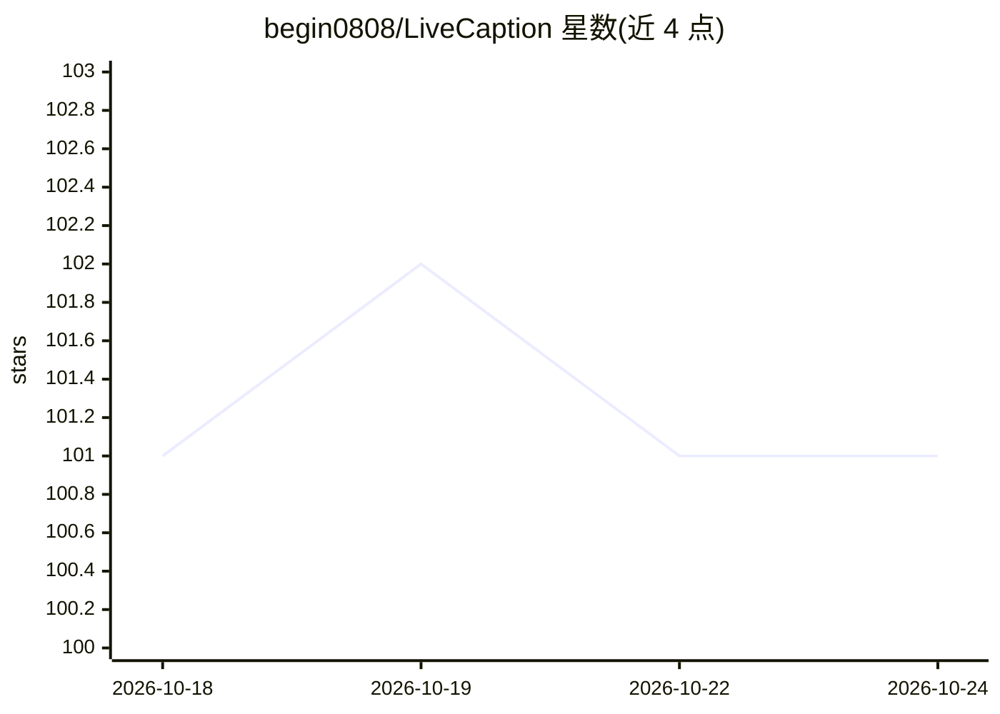

# begin0808/LiveCaption

⭐ 101 · HTML · 推送 2026-07-31 · [GitHub](https://github.com/begin0808/LiveCaption) · 个人维护 · 中文 README

**本机离线的网页影片实时双语字幕系统（Chrome 扩展+Python 后端）**

面向浏览器影片观看场景的实时语音识别与双语字幕翻译系统：Chrome 扩展以 tabCapture 擷取分页音讯，经 WebSocket 串流传至本机 Python 后端，用 Silero VAD 流式断句、Sherpa-ONNX 运行的 SenseVoice-Small 做离线语音识别，识别限中/英/日/韩/粤语。翻译引擎按 DeepSeek→Ollama→Google Translate 顺序择一，前两者需自行安装或申请金钥。提供 Windows 一键离线发布包，也可从源码跨平台运行。

## 筛选速览

| 维度 | 判定 | 备注 |
|---|---|---|
| AI 角色 | `ai-native` | 本体是模型或模型工具 |
| 许可风险 | `permissive` | — |
| 部署形态 | `desktop` | 安装包/桌面程序 |
| 模型依赖 | local-ok | 支持本地模型 |
| 硬件要求 | — | 无带数字的原话,不猜 |
| 安装摩擦 | `low` | 无编译、无系统依赖或容器化 |
| 成熟度 | — | 结构信号不足 |

## 能力要点

- 分页音讯独佔擷取，不占用麦克风/喇叭
- Silero VAD 流式断句 + SenseVoice-Small 本机离线识别
- 翻译引擎热插拔：DeepSeek 云端 / Ollama 本机 / Google Translate 备援
- 毛玻璃字幕悬浮窗，可自订字体、拖拽定位

## 适用场景

- 看外语影片或直播时显示双语实时字幕
- 线上学习、视讯会议内容的即时文字记录
- 听障辅助与外语练习
- 低配电脑上用免费 Google Translate 获得开箱即用字幕

## 场景标签

`语音识别` · 领域:感知与多模态

## 证据(README 行号)

> L11: Studio0808 LiveCaption 是一套專為瀏覽器影片設計的即時語音識別與雙語字幕翻譯系統。完全在您的本機電腦執行，擁有 100% 的隱私保護與極低延遲的解碼速度。
> L26:  - 後端利用高效的 **Silero VAD (語音活動檢測)** 進行即時流式監聽與斷句（預設當說話停頓達 0.5 秒時自動切分句子），並在句子結束的瞬間交給 **SenseVoice-Small** 大模型進行高速本機解碼。
> L44: * **本機離線 AI 語音辨識**：後端搭載 Sherpa-ONNX 架構與阿里巴巴開源的 **SenseVoice-Small** 語音大模型，支援中、英、日、韓、粵語等語音，離線解碼速度極快，準確度高。

## 星数曲线

2026-10-18 101 → 2026-10-24 101（+0）

---
*卡片 v1 · prompt 1.4 · 生成 2026-10-23 · 置信度 mid · 依据 README sha `471fb5d370dc` · [字段定义](../../DATASET.md)*
