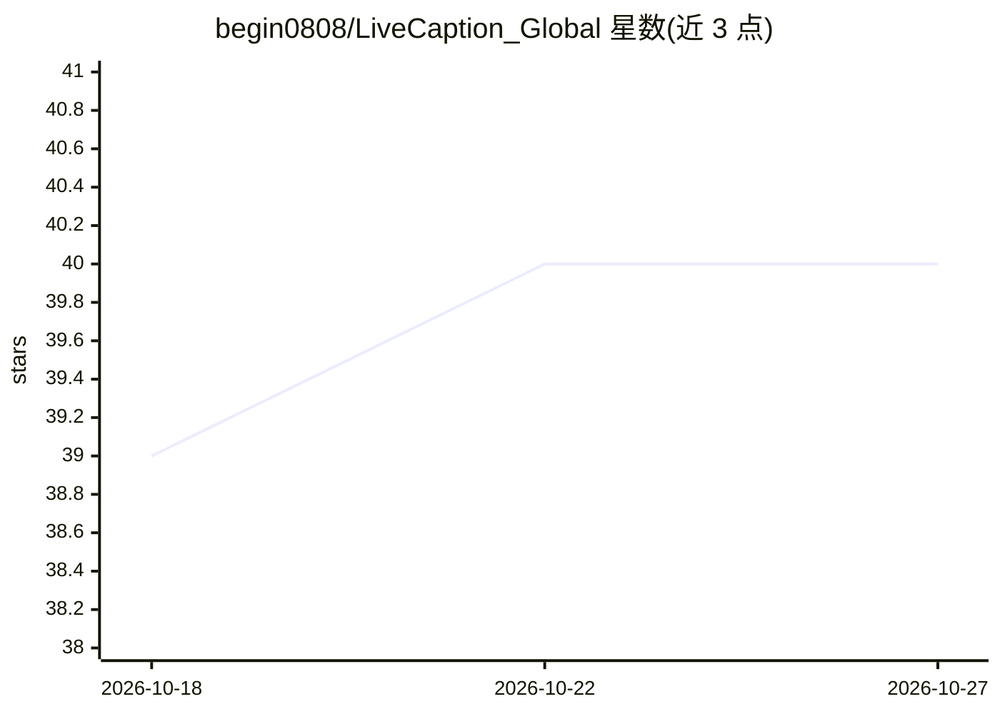

# begin0808/LiveCaption_Global

⭐ 40 · JavaScript · 推送 2026-07-31 · [GitHub](https://github.com/begin0808/LiveCaption_Global) · [官网](https://begin0808.github.io/LiveCaption_Global/) · 个人维护 · 中文 README

**为浏览器影片提供本机离线实时双语字幕的 Chrome 扩展系统**

由 Python 后端与 Chrome 扩展组成的实时字幕系统：扩展通过 tabCapture 擷取分页音讯，经 WebSocket 串流至后端，用 Silero VAD 断句后交由 SenseVoice-Small（中英日韩粤）或 Whisper（全球近百语言）本机辨識，翻譯引擎可在本機 Ollama（推薦 Qwen 2.5）、DeepSeek API、Google 翻譯間切換，全程本机执行。适合线上学习、听障辅助、外语练习等场景。提供 Windows 一键离线整合包，macOS/Linux 需从源码运行。

## 筛选速览

| 维度 | 判定 | 备注 |
|---|---|---|
| AI 角色 | `ai-native` | 本体是模型或模型工具 |
| 许可风险 | `permissive` | — |
| 部署形态 | `desktop` | 安装包/桌面程序 |
| 模型依赖 | local-ok | 支持本地模型 |
| 硬件要求 | — | 无带数字的原话,不猜 |
| 安装摩擦 | `low` | 无编译、无系统依赖或容器化 |
| 成熟度 | — | 结构信号不足 |

## 能力要点

- 分页音讯独立擷取，不占用麦克风/喇叭
- Silero VAD 流式断句，句级字幕延迟约 100-300ms
- 双 ASR 引擎（SenseVoice-Small + Whisper）覆盖 100+ 语言
- 翻译引擎热插拔：Ollama / DeepSeek / Google Translate

## 适用场景

- 观看外语影片时获得实时双语字幕
- 听障用户辅助理解网页影音内容
- 视讯会议与线上课程的实时文字记录
- 无 GPU 或离线环境下用 Google 翻译作备用字幕

## 场景标签

`语音识别` · 领域:感知与多模态

## 证据(README 行号)

> L12: Studio0808 LiveCaption（全球語系版本）是一套專為瀏覽器影片設計的即時語音識別與雙語字幕翻譯系統。後端整合 **Whisper 多國語言引擎**（支援法、德、西、義、俄、葡等全球近百種語言）與 **SenseV
> L42: * **雙引擎本機離線 AI 語音辨識**：後端搭載 Sherpa-ONNX 架構，整合 **SenseVoice-Small**（中、英、日、韓、粵語亞太極速辨識）與 **Whisper**（法、德、西、義、俄等全球近百種語言高

## 星数曲线

2026-10-18 39 → 2026-10-27 40（+1）

---
*卡片 v1 · prompt 1.4 · 生成 2026-10-25 · 置信度 high · 依据 README sha `70b8ac949119` · [字段定义](../../DATASET.md)*
