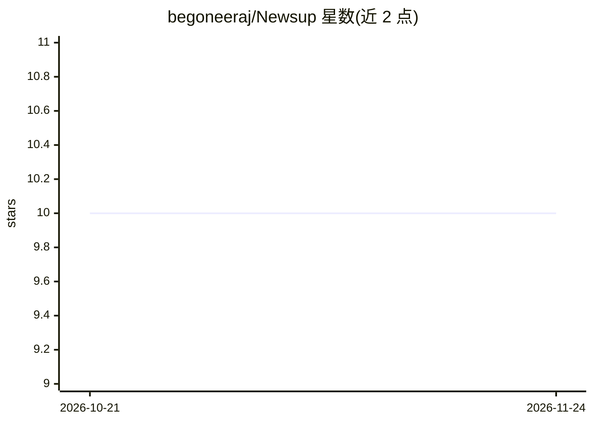

# begoneeraj/Newsup

⭐ 10 · Python · MIT · 推送 2026-10-28 · [GitHub](https://github.com/begoneeraj/Newsup) · [官网](https://github.com/begoneeraj/Newsup/releases) · 个人维护

**面向印度学生的新闻事实核查与机构危机追踪 Android 应用**

Flutter + Supabase 构建的印度新闻事实核查与危机追踪应用：从 Google News、NewsData.io、RSS、Reddit 等来源抓取新闻，自动提取声明并用 AI 生成判定、置信度与通俗分析；对 NEET 泄题、RTI 逾期、法院案件等长周期事件升级到更大模型生成时间线。证据仅引用 PIB、部委、法院等官方来源，注明报道媒体数量，不指控媒体。Android 端提供 APK 直接下载，后端管线需自备 Groq/Supabase 密钥运行。

## 筛选速览

| 维度 | 判定 | 备注 |
|---|---|---|
| AI 角色 | `ai-native` | 本体是模型或模型工具 |
| 许可风险 | `permissive` | MIT |
| 部署形态 | `library` | 以包/库形式分发 |
| 模型依赖 | locked-api |  |
| 硬件要求 | — | 无带数字的原话,不猜 |
| 安装摩擦 | `low` | 无编译、无系统依赖或容器化 |
| 成熟度 | — | 结构信号不足 |

## 能力要点

- 每条新闻自动提取声明并生成判定、置信度与通俗分析，约每两小时刷新
- Llama 3.1 8B 做常规核查、Llama 3.3 70B 做危机时间线分析（经 Groq）
- 事实核查层仅引用官方来源（PIB、部委、法院）且争议时呈现双方
- 危机报告推送通知与可分享判定卡片

## 适用场景

- 查看印度新闻声明的核查判定与媒体覆盖情况
- 追踪泄题、RTI、法院案件等持续数月的机构危机
- 接收新危机报告的推送并分享判定卡片

## 场景标签

`AI 助手` · 领域:对话与助手

## 证据(README 行号)

> L20: TruthLens India pulls in Indian news from a dozen different places, runs every claim through an AI fact-checker, an
> L93: |AI|Groq (Llama 3.1 8B for routine checks, Llama 3.3 70B for crisis/claim analysis)|

## 星数曲线

2026-10-21 10 → 2026-11-24 10（+0）

---
*卡片 v1 · prompt 1.4 · 生成 2026-11-19 · 置信度 high · 依据 README sha `ed2103643dab` · [字段定义](../../DATASET.md)*
