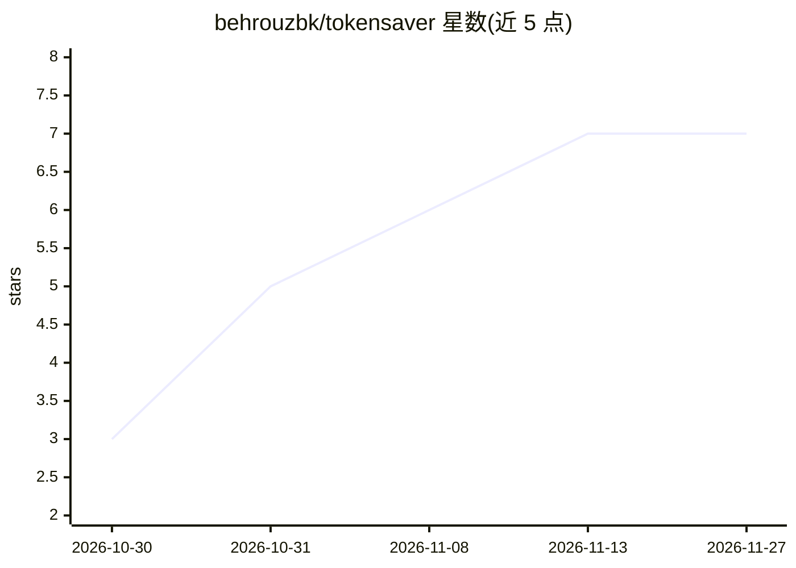

# behrouzbk/tokensaver

⭐ 7 · Python · MIT · 推送 2026-11-09 · [GitHub](https://github.com/behrouzbk/tokensaver) · 个人维护 · 中文 README

**提示词令牌计数与成本优化 CLI：离线给出省钱建议**

tokensaver 是一个 Python CLI 工具：对提示词做令牌计数（部分模型用官方计数器校准，其余为估算）、跨 20 个模型对比输入成本、并给出带理由与美元节省额的优化建议（JSON 压缩、空白清理、重复段落检测等规则），输出 before/after diff；支持任意语言与脚本，含从右到左文字。全部计算离线运行，提示词不出本机，无需 API key。需要 Python 3.10+，支持 Windows/macOS/Linux。优化建议的措辞类规则目前仅支持英语（filler 另支持波斯语）。

## 筛选速览

| 维度 | 判定 | 备注 |
|---|---|---|
| AI 角色 | `ai-ecosystem` | LLM/agent 周边工具 |
| 许可风险 | `permissive` | MIT |
| 部署形态 | `library` | 以包/库形式分发 |
| 模型依赖 | — | README 未给出锁定关系 |
| 硬件要求 | — | 无带数字的原话,不猜 |
| 安装摩擦 | `low` | 无编译、无系统依赖或容器化 |
| 成熟度 | — | 结构信号不足 |

## 能力要点

- 跨模型令牌计数与成本对比，Claude/Gemini 估算经官方计数器校准
- 优化建议附带令牌节省与美元金额及 diff，可分级应用 safe/all
- 100% 离线运行，提示词不出本机
- scan 命令批量测量文件夹内全部提示词文件；支持 prompt caching 成本估算

## 适用场景

- 多语言提示词在上线前对比各模型调用成本
- 压缩系统提示词降低每次调用的输入费用
- 批量扫描仓库中所有提示词文件找出可缩减部分
- 估算固定部分在 prompt caching 下的实际成本

## 场景标签

`提示工程` · 领域:Agent 开发

## 证据(README 行号)

> L3: **Same prompt, different bill: tokensaver shows what your prompt costs on 20 models, in any language, and exactly wh
> L44: It runs 100% offline. Your prompt never leaves your machine.
> L100: pip install prompt-tokensaver

## 星数曲线

2026-10-30 3 → 2026-11-27 7（+4）

---
*卡片 v1 · prompt 1.4 · 生成 2026-11-20 · 置信度 high · 依据 README sha `6573e40be9f9` · [字段定义](../../DATASET.md)*
