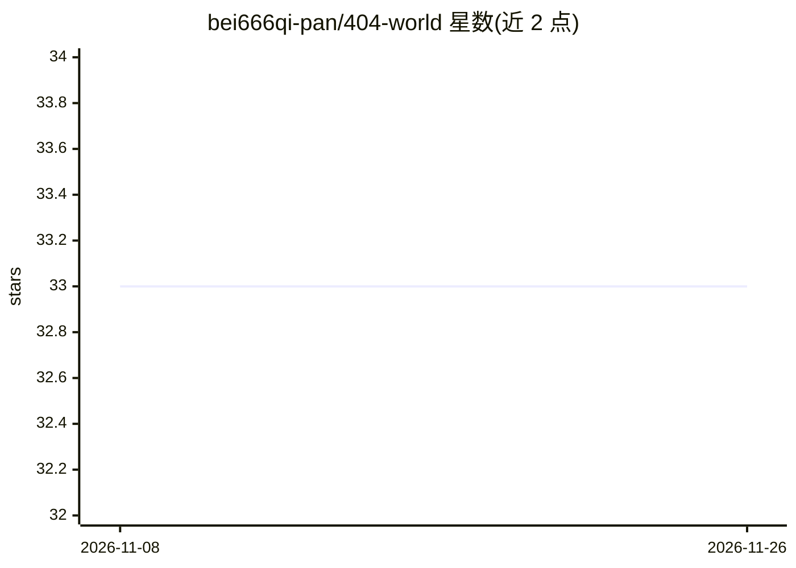

# bei666qi-pan/404-world

⭐ 33 · TypeScript · MIT · 推送 2026-11-05 · [GitHub](https://github.com/bei666qi-pan/404-world) · [官网](https://versecraft.cn) · 个人维护 · 中文 README

**AI 互动小说平台：玩家写行动，AI 续写故事**

AI 驱动的互动式叙事服务：用户选择故事扮演主角，既可从选项中挑选行动，也可用自然语言自写行动，由 AI 接续生成剧情；同时支持用户自建人物与开篇创作互动故事并邀请他人阅读。提供书架进度保存、跨手机/桌面浏览器阅读，无需注册即有每日免费体力，界面支持中文、English、日本語。本仓库仅保留早期版本（原名文界工坊 VerseCraft）的公开源码，当前线上服务使用另一套未公开的代码库。

## 筛选速览

| 维度 | 判定 | 备注 |
|---|---|---|
| AI 角色 | `ai-native` | 本体是模型或模型工具 |
| 许可风险 | `permissive` | MIT |
| 部署形态 | `None` |  |
| 模型依赖 | — | README 未给出锁定关系 |
| 硬件要求 | — | 无带数字的原话,不猜 |
| 安装摩擦 | `low` | 无编译、无系统依赖或容器化 |
| 成熟度 | `idea` | |

## 能力要点

- 玩家自写行动，AI 接续生成剧情
- 支持自建人物与开篇创作互动故事
- 无需注册，每日提供免费体力
- 界面支持中文、English、日本語

## 适用场景

- 在浏览器中阅读并参与 AI 互动小说
- 创作自己的互动故事并邀请他人阅读
- 保存进度，随时从书架续读

## 场景标签

`AI 写作` · 领域:内容生成

## 证据(README 行号)

> L14: 选一本故事，扮演主角。选择下一步，或写下自己想做的事，AI 会接着写下你的故事。你也可以创作自己的故事，邀请他人来读。
> L16: Choose a story and step into the lead role. Pick your next move or write your own action, and AI continues the stor

## 星数曲线

2026-11-08 33 → 2026-11-26 33（+0）

---
*卡片 v1 · prompt 1.4 · 生成 2026-11-18 · 置信度 high · 依据 README sha `9efb30709f30` · [字段定义](../../DATASET.md)*
