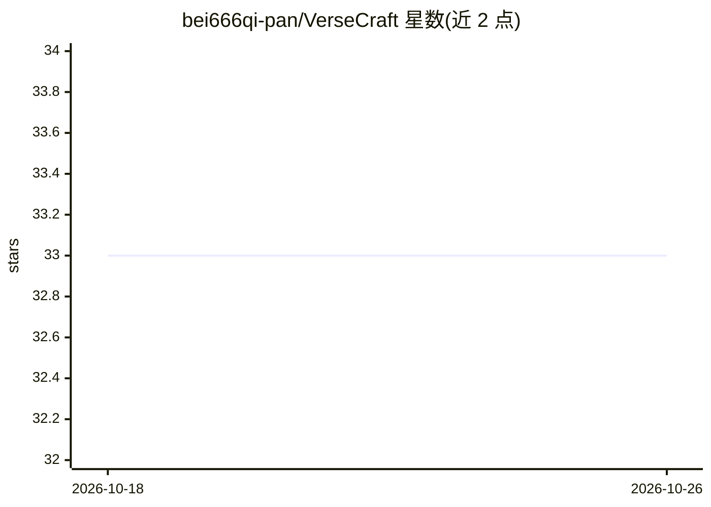

# bei666qi-pan/VerseCraft

⭐ 33 · TypeScript · MIT · 推送 2026-09-03 · [GitHub](https://github.com/bei666qi-pan/VerseCraft) · [官网](https://versecraft.cn) · 个人维护 · 中文 README

**浏览器端 AI 互动小说引擎：玩家自由输入行动，世界规则结算后果**

基于 Next.js/React/TypeScript 的 AI 互动叙事运行时：玩家用自然语言书写行动，回合路由器结合世界知识与角色知识边界，由 AI 提议结果、经类型化回合管线校验后提交结构化状态变更；后台世界导演推进 NPC 议程。内置中文悬疑恐怖世界《序章·暗月》的单一玩家原型，当前针对简体中文游玩优化。本地运行需克隆源码、pnpm 安装、配置 .env，完整运行还需 PostgreSQL、Redis 与 OpenAI 兼容网关凭据。

## 筛选速览

| 维度 | 判定 | 备注 |
|---|---|---|
| AI 角色 | `ai-native` | 本体是模型或模型工具 |
| 许可风险 | `permissive` | MIT |
| 部署形态 | `library` | 以包/库形式分发 |
| 模型依赖 | — | README 未给出锁定关系 |
| 硬件要求 | — | 无带数字的原话,不猜 |
| 安装摩擦 | `low` | 无编译、无系统依赖或容器化 |
| 成熟度 | `idea` | |

## 能力要点

- 玩家自由语言输入行动，非固定选项分支
- AI 提议结果+类型化回合管线校验并提交权威状态增量
- 背景世界导演异步推进 NPC 议程与未来事件
- 世界观检索、认知边界过滤与叙事后校验防止编造入正典

## 适用场景

- 在浏览器中游玩由 AI 实时结算的互动小说
- 团队探索 AI 原生互动叙事平台的原型基础
- 在现有引擎上扩展校园、科幻、奇幻等其他题材世界

## 场景标签

 · 领域:游戏/互动叙事

## 证据(README 行号)

> L21: > **Not a novel in a chat box.** VerseCraft is a browser-based story runtime: players write what they do in natural
> L42: |**Resolve a turn**|An AI story runner proposes an outcome; a typed turn pipeline validates and commits the authori

## 星数曲线

2026-10-18 33 → 2026-10-26 33（+0）

---
*卡片 v1 · prompt 1.4 · 生成 2026-10-25 · 置信度 mid · 依据 README sha `07e7d609c86c` · [字段定义](../../DATASET.md)*
