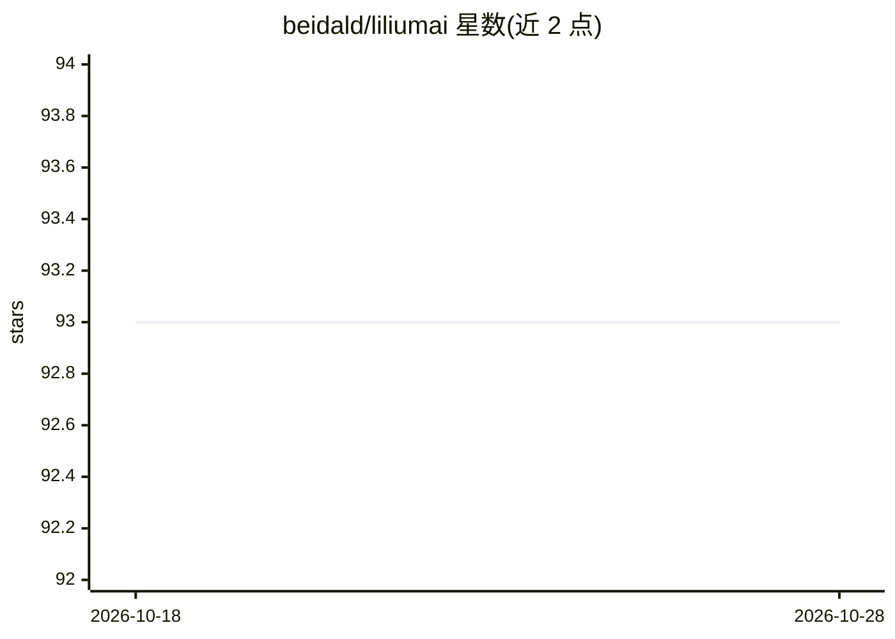

# beidald/liliumai

⭐ 93 · TypeScript · MIT · 推送 2026-02-25 · [GitHub](https://github.com/beidald/liliumai) · [官网](https://liliumai.cn) · 个人维护 · 中文 README

**个人 AI 智能体框架：让 LLM 自主操控浏览器、Shell 与多渠道通讯**

基于 Node.js 的个人 AI agent 框架，将 OpenAI、Claude、Ollama 等 LLM 接入 Puppeteer 浏览器自动化、Shell 执行、文件读写与 Cron 定时任务，实现端到端自主执行。支持后台子 agent、SQLite/LanceDB 长期记忆与 RAG 知识库、Whisper 语音转文字，并可接入微信、飞书、钉钉、Telegram、WhatsApp、Discord 等渠道。通过插件目录扩展技能，配置 config.json 后以 pnpm 启动。README 明确提示微信等平台的自动化操作有违反服务条款与封号风险。

## 筛选速览

| 维度 | 判定 | 备注 |
|---|---|---|
| AI 角色 | `ai-native` | 本体是模型或模型工具 |
| 许可风险 | `permissive` | MIT |
| 部署形态 | `library` | 以包/库形式分发 |
| 模型依赖 | local-ok | 支持本地模型 |
| 硬件要求 | — | 无带数字的原话,不猜 |
| 安装摩擦 | `low` | 无编译、无系统依赖或容器化 |
| 成熟度 | — | 结构信号不足 |

## 能力要点

- 浏览器自动化与 Shell/文件系统/Cron 系统级控制
- 微信、飞书、钉钉、Telegram、WhatsApp、Discord 等多渠道接入
- 长期记忆（SQLite/LanceDB）与 RAG 知识库
- 丢 JS 文件进 plugins/ 目录即可扩展技能

## 适用场景

- 每天定时登录 GitHub 汇总 issue 并发送报告到微信
- 监控网页价格变动并通过 Telegram/Slack 通知
- 语音指令转录后控制电脑执行任务
- 个人 7x24 小时本地优先的跨平台数字助手

## 场景标签

`Agent 框架` `浏览器自动化` · 领域:Agent 开发

## 证据(README 行号)

> L8: Lilium AI is a powerful personal AI agent framework designed for **autonomous execution**. It connects Large Languag
> L17: - **🧠 Multi-LLM Support**: Seamlessly switch between OpenAI, Claude, Ollama (local models), and more.

## 星数曲线

2026-10-18 93 → 2026-10-28 93（+0）

---
*卡片 v1 · prompt 1.4 · 生成 2026-10-23 · 置信度 mid · 依据 README sha `72f0776e2931` · [字段定义](../../DATASET.md)*
