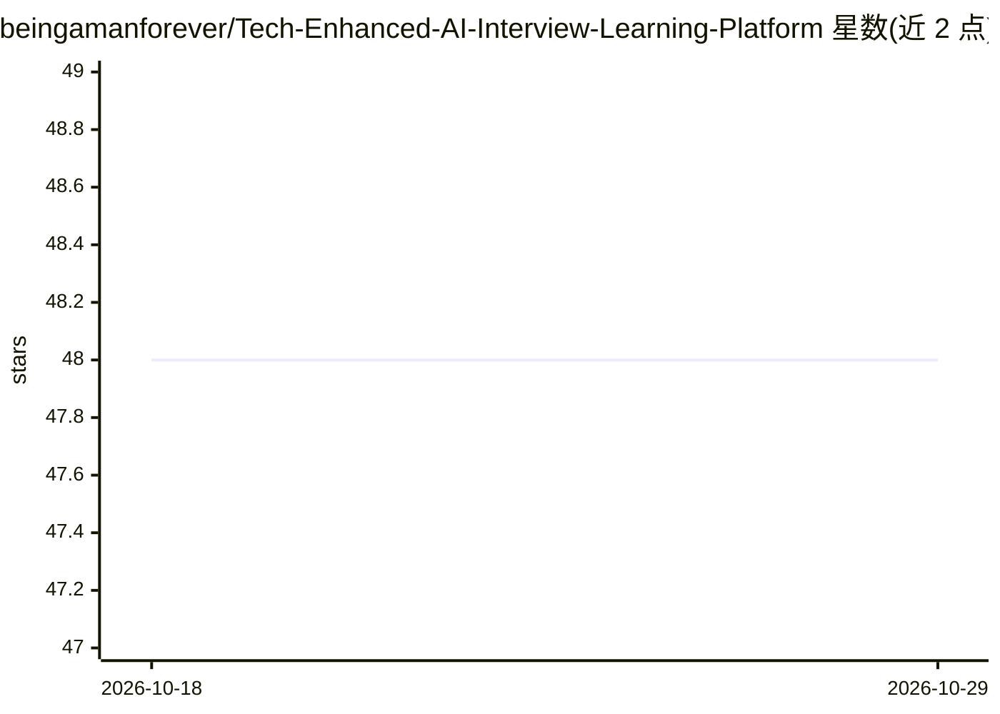

# beingamanforever/Tech-Enhanced-AI-Interview-Learning-Platform

⭐ 48 · Jupyter Notebook · Apache-2.0 · 推送 2025-12-13 · [GitHub](https://github.com/beingamanforever/Tech-Enhanced-AI-Interview-Learning-Platform) · 个人维护

**AI 模拟面试平台：语音对话提问并纠正语法与语速**

面向求职者的对话式面试练习 Web 应用：用户选择面试领域后，通过音频或文本与微调后的 Mistral 7B Instruct 模型对话，模型按上下文生成面试问题、纠正回答中的语法错误，并基于 Faster Whisper + CTranslate2 做语音转文字，附带语速检测反馈（1-3 词/秒为可接受区间）。训练流程使用 QLoRA 4-bit 量化与 PEFT 库，数据集（含 ChatGPT 生成的合成数据，1742 训练/581 测试条目）发布于 Hugging Face Hub。前端 HTML/CSS，后端 JavaScript/Flask。曾对比 Phi2 微调效果后选用 Mistral 7B。README 记录训练受 Kaggle GPU 时长限制，epoch 数较少。

## 筛选速览

| 维度 | 判定 | 备注 |
|---|---|---|
| AI 角色 | `ai-native` | 本体是模型或模型工具 |
| 许可风险 | `permissive` | Apache-2.0 |
| 部署形态 | `library` | 以包/库形式分发 |
| 模型依赖 | — | README 未给出锁定关系 |
| 硬件要求 | — | 无带数字的原话,不猜 |
| 安装摩擦 | `low` | 无编译、无系统依赖或容器化 |
| 成熟度 | — | 结构信号不足 |

## 能力要点

- Mistral 7B Instruct 用 QLoRA（4-bit 量化 + PEFT）微调生成面试问题并纠正语法
- Faster Whisper + CTranslate2 做语音转文字并计算语速反馈
- 训练数据集（含合成数据）发布于 Hugging Face Hub
- Flask 后端串联语音转录与 LLM 问答

## 适用场景

- 求职者按目标岗位进行模拟面试练习
- 通过语音对话训练并获取语法与语速反馈
- 在自定义数据集上复现 Mistral QLoRA 微调流程

## 场景标签

`聊天机器人` `语音识别` `微调` · 领域:对话与助手

## 证据(README 行号)

> L5: The Chatbot Interviewer is a conversational AI system designed to engage in natural language interactions with users
> L205: - We then feed this text into our fine tuned mistral model, which then asks the user questions based on the domain

## 星数曲线

2026-10-18 48 → 2026-10-29 48（+0）

---
*卡片 v1 · prompt 1.4 · 生成 2026-10-25 · 置信度 mid · 依据 README sha `6c719f3901a3` · [字段定义](../../DATASET.md)*
