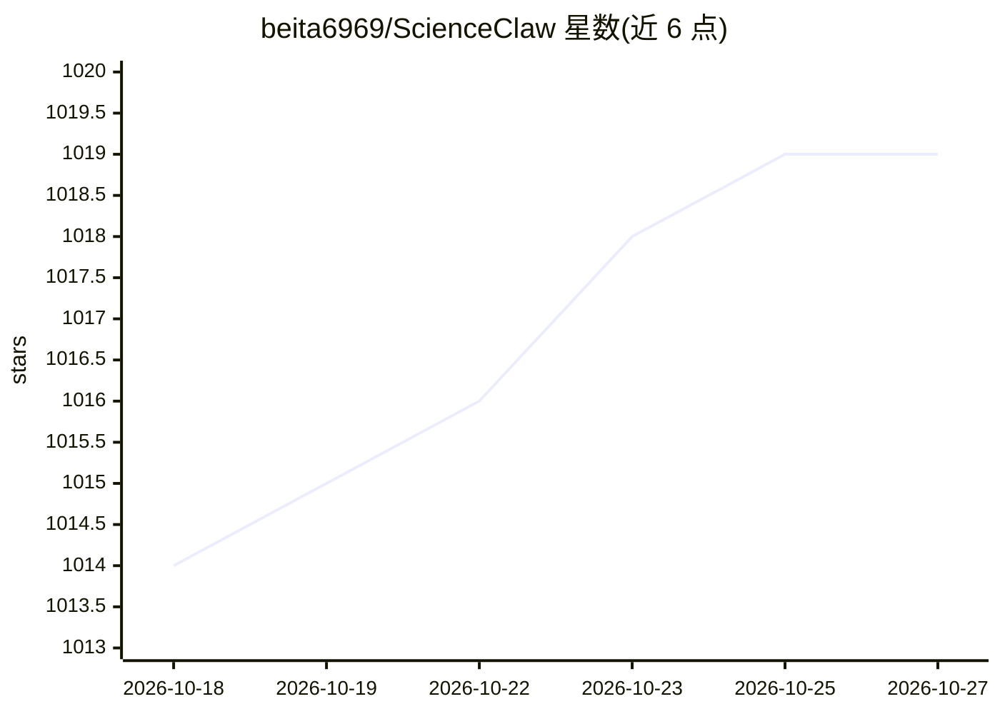

# beita6969/ScienceClaw

⭐ 1,019 · TypeScript · MIT · 推送 2026-10-26 · [GitHub](https://github.com/beita6969/ScienceClaw) · [官网](https://scienceclaw.science) · 个人维护

**可验证程序级自我进化的科研 agent 系统（Skill–Operator）**

面向科研任务的 agent 系统：以带类型契约的可执行工作流求解任务，当修复在干净重放中复现时，转化为成对的 Skill（策略）与 Operator（类型化能力），并经重放与独立验证双重门控后才持久化，可回滚、可版本化。覆盖 23 个学科评测。基于 OpenClaw 网关构建，自带 setup.sh 一键安装 Node/Python/工具与权重（完整配置约下载 19 GB 权重），支持任意 OpenAI 兼容端点或本地程序作为模型后端，配有 arXiv 论文与 Hugging Face 基准数据。

## 筛选速览

| 维度 | 判定 | 备注 |
|---|---|---|
| AI 角色 | `ai-native` | 本体是模型或模型工具 |
| 许可风险 | `permissive` | MIT |
| 部署形态 | `library` | 以包/库形式分发 |
| 模型依赖 | — | README 未给出锁定关系 |
| 硬件要求 | — | 无带数字的原话,不猜 |
| 安装摩擦 | `low` | 无编译、无系统依赖或容器化 |
| 成熟度 | — | 结构信号不足 |

## 能力要点

- 重放验证驱动的 Skill–Operator 程序级自进化机制
- 端口携带类型/形状/单位/溯源 schema 的可执行工作流，节点指纹检查点
- 更新须经源任务重放与独立验证任务严格改进双重门控，无需 LLM 裁判
- 模型后端可替换：任意 OpenAI 兼容端点、本地程序或自有后端

## 适用场景

- 让科研 agent 在使用中持续积累可复用的策略与能力
- 跨学科科研任务以类型化工作流方式求解与复现
- 需要可回滚、可验证的 agent 程序更新机制的研究实验

## 场景标签

`科研工具` · 领域:学习与行业

## 证据(README 行号)

> L27: ScienceClaw is an agent system for scientific work that **gets better the more it is used**. It solves each task as
> L30: > This repository is the **agent system**, built on the OpenClaw gateway. Its companion benchmark, **ScienceClaw-Ev

## 星数曲线

2026-10-18 1,014 → 2026-10-27 1,019（+5）

---
*卡片 v1 · prompt 1.4 · 生成 2026-10-21 · 置信度 high · 依据 README sha `5c62413635f1` · [字段定义](../../DATASET.md)*
