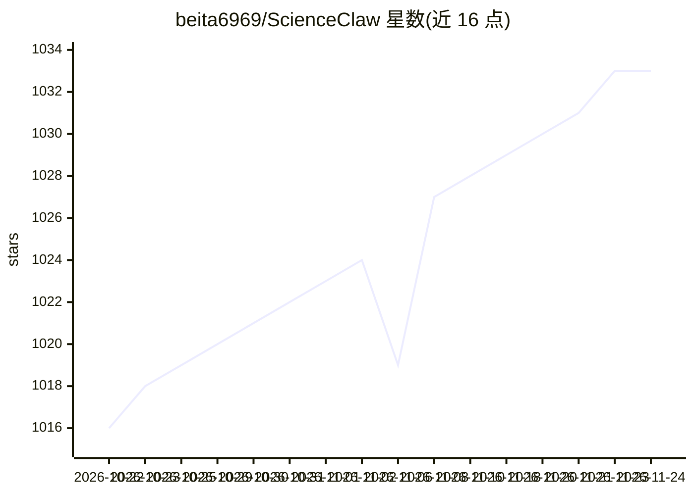

# beita6969/ScienceClaw

⭐ 1,033 · TypeScript · MIT · 推送 2026-11-20 · [GitHub](https://github.com/beita6969/ScienceClaw) · [官网](https://scienceclaw.science) · 个人维护

**科研 agent 系统：执行证据经重放验证后固化为可复用技能与算子**

面向科学任务的 agent 系统：将每个任务求解为带类型契约的可执行工作流，修复若在重置环境中复现并通过独立验证任务，则固化为 Skill（策略）与 Operator（类型化可执行能力），以版本化快照形式持久化、可晋升与回滚，不更新基础模型参数。本仓库是 agent 系统，构建于 OpenClaw 网关之上；配套基准 ScienceClaw-Eval 数据托管在 Hugging Face。完整安装需 Node/Python 环境，约下载 19 GB 预训练权重。

## 筛选速览

| 维度 | 判定 | 备注 |
|---|---|---|
| AI 角色 | `ai-ecosystem` | LLM/agent 周边工具 |
| 许可风险 | `permissive` | MIT |
| 部署形态 | `library` | 以包/库形式分发 |
| 模型依赖 | — | README 未给出锁定关系 |
| 硬件要求 | — | 无带数字的原话,不猜 |
| 安装摩擦 | `low` | 无编译、无系统依赖或容器化 |
| 成熟度 | — | 结构信号不足 |

## 能力要点

- 重放门控的 Skill–Operator 联动更新，无需 LLM 评审来形成或筛选候选
- 类型化工作流：端口携带类型/形状/单位/来源 schema，节点指纹化后仅重跑受影响部分
- 每次结果在重置环境中重新生成并按硬科学约束校验
- 接入任意 OpenAI 兼容端点、本地程序或自定义后端，不绑定模型家族

## 适用场景

- 让科研 agent 在多次使用中积累可复现的策略与算子
- 需要单位、收敛、可复现性等硬约束校验的科学计算任务
- 在 23 个自然与社会科学学科上运行科研自动化工作流

## 场景标签

`科研工具` · 领域:学习与行业

## 证据(README 行号)

> L27: ScienceClaw is an agent system for scientific work that **gets better the more it is used**. It solves each task as
> L30: > This repository is the **agent system**, built on the OpenClaw gateway. Its companion benchmark, **ScienceClaw-Ev
> L65: > **Bring your own model.** The engine never assumes a model family and this repository names none. Point it at any

## 星数曲线

2026-10-22 1,016 → 2026-11-24 1,033（+17）

---
*卡片 v1 · prompt 1.4 · 生成 2026-11-24 · 置信度 high · 依据 README sha `0717449b7f68` · [字段定义](../../DATASET.md)*
