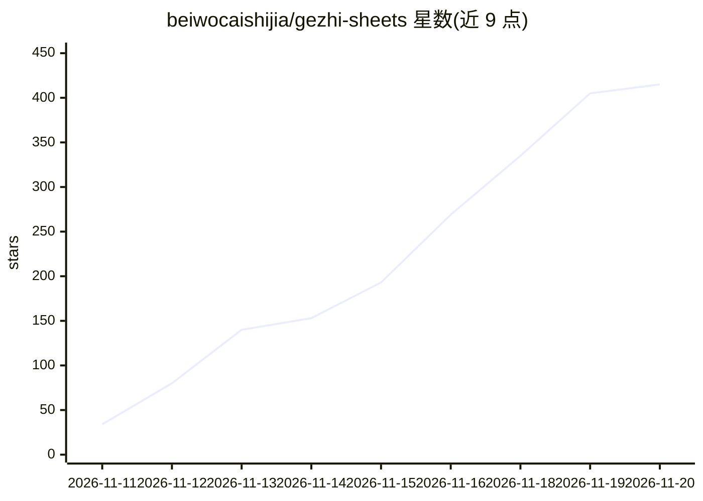

# beiwocaishijia/gezhi-sheets

⭐ 415 · JavaScript · MIT · 推送 2026-11-18 · [GitHub](https://github.com/beiwocaishijia/gezhi-sheets) · 个人维护 · 中文 README

**接入国产大模型的本地 AI 表格助手，用自然语言整理表格**

运行于 Windows + Node.js 的本机表格工作台：选中单元格区域，用中文描述需求，由所选模型（GLM/Kimi/豆包/DeepSeek/Qwen）生成提取、分类、摘要、翻译、文字转表、公式与排序等建议，经预览确认后写回，支持一次撤销。每家厂商独立配置 API Key（Windows DPAPI 加密保存），AI 任务仅上传指定范围。限制：每表 1000 行、100 列，工作簿 20 张表，导入上限 10MB，公式白名单有限。

## 筛选速览

| 维度 | 判定 | 备注 |
|---|---|---|
| AI 角色 | `ai-native` | 本体是模型或模型工具 |
| 许可风险 | `permissive` | MIT |
| 部署形态 | `None` |  |
| 模型依赖 | locked-api |  |
| 硬件要求 | — | 无带数字的原话,不猜 |
| 安装摩擦 | `low` | 无编译、无系统依赖或容器化 |
| 成熟度 | `idea` | |

## 能力要点

- 五家厂商适配，API Key 本机 DPAPI 加密保存
- 选择范围→生成预览→确认应用→一次撤销的修改流程
- 中文自然语言生成公式并逐行试算
- Excel/CSV 导入、自动保存与版本备份

## 适用场景

- 批量整理客户反馈、提取需求类别与摘要
- 把订单文字、会议纪要转成结构化表格
- 用中文描述计算逻辑，让 AI 生成公式并核对结果

## 场景标签

`AI 助手` · 领域:对话与助手

## 证据(README 行号)

> L7: 选中数据，说出需求。让 AI 提取、整理和计算，再由你确认写入。
> L40:  说“数量乘单价”，生成公式并逐行试算。支持解释与排错，计算交给程序完成。
> L60: **GLM · Kimi · 豆包 · DeepSeek · Qwen 千问**

## 星数曲线

2026-11-11 34 → 2026-11-20 415（+381）

---
*卡片 v1 · prompt 1.4 · 生成 2026-11-17 · 置信度 high · 依据 README sha `fbb66c5690f6` · [字段定义](../../DATASET.md)*
