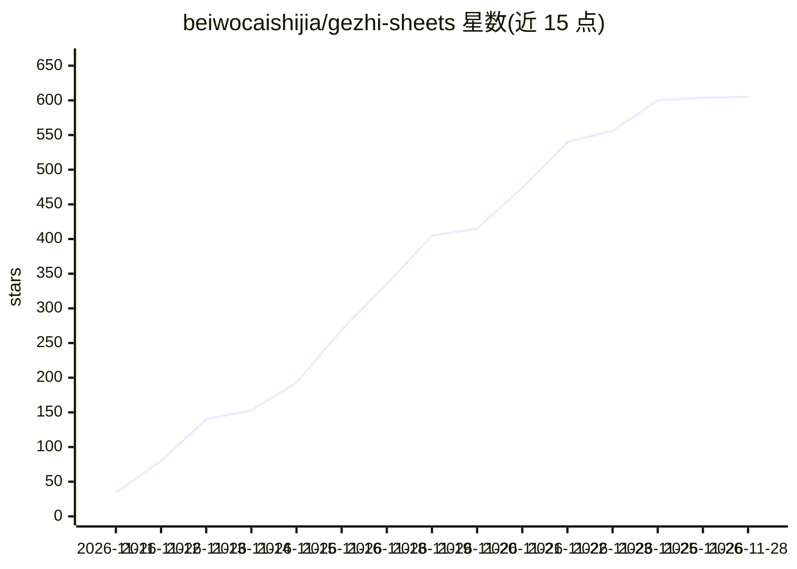

# beiwocaishijia/gezhi-sheets

⭐ 605 · JavaScript · MIT · 推送 2026-11-18 · [GitHub](https://github.com/beiwocaishijia/gezhi-sheets) · 个人维护 · 中文 README

**本地 AI 表格助手：一句话对表格提取、整理与计算**

运行在本机的表格工作台，用户选中数据后用中文描述需求，AI 生成修改预览，确认后写入并支持一次撤销。提供批量填列、文字转表、整理数据、表格问答、公式助手、表格操作六类能力；统计与筛选由受限查询计划经程序执行，公式逐行试算。内置 GLM、Kimi、豆包、DeepSeek、Qwen 五家适配器，各自配置 API Key，密钥经 Windows DPAPI 本机加密。限制：每表最多 1000 行 100 列，导入上限 10 MB，首版无账号系统与协作。

## 筛选速览

| 维度 | 判定 | 备注 |
|---|---|---|
| AI 角色 | `ai-native` | 本体是模型或模型工具 |
| 许可风险 | `permissive` | MIT |
| 部署形态 | `None` |  |
| 模型依赖 | locked-api |  |
| 硬件要求 | — | 无带数字的原话,不猜 |
| 安装摩擦 | `low` | 无编译、无系统依赖或容器化 |
| 成熟度 | `idea` | |

## 能力要点

- 生成预览→确认应用→一次撤销的可控写入流程
- 五家国产模型适配器，独立 API Key 与模型配置
- API Key 经 Windows DPAPI 本机加密，工作簿保存在本机
- 受限查询计划由程序执行统计，含糊操作先追问

## 适用场景

- 把客户留言批量提取成需求类别与摘要列
- 将订单、清单等文字整理成结构化工作表
- 用中文描述计算需求生成公式并试算
- 导入 Excel/CSV 做分类汇总与表格问答

## 场景标签

`数据分析` `AI 助手` · 领域:效率与自动化

## 证据(README 行号)

> L7: 选中数据，说出需求。让 AI 提取、整理和计算，再由你确认写入。
> L60: **GLM · Kimi · 豆包 · DeepSeek · Qwen 千问**
> L72: API Key 在本机通过 **Windows DPAPI** 加密保存，重启后可继续使用。工作簿保存在本机；发起 AI 任务时，只把指定范围交给你选择的厂商。

## 星数曲线

2026-11-11 34 → 2026-11-28 605（+571）

---
*卡片 v1 · prompt 1.4 · 生成 2026-11-25 · 置信度 high · 依据 README sha `ae447dea6838` · [字段定义](../../DATASET.md)*
