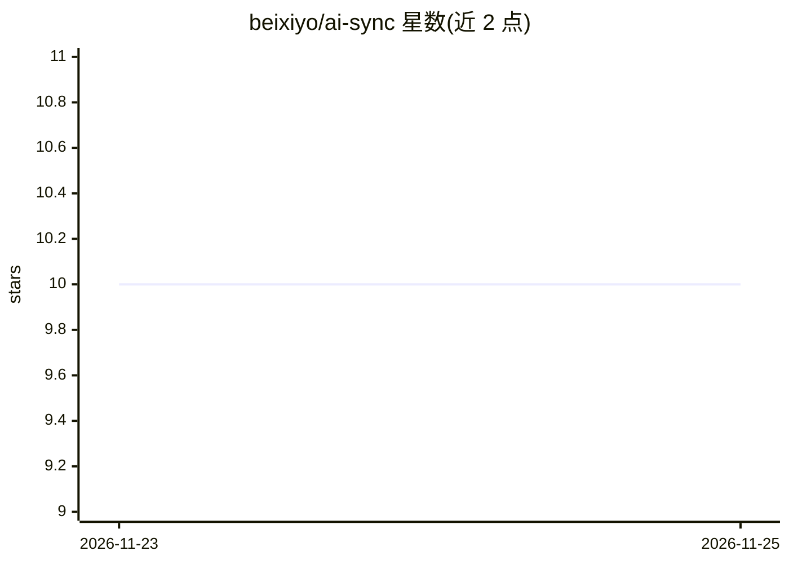

# beixiyo/ai-sync

⭐ 10 · TypeScript · MIT · 推送 2026-11-18 · [GitHub](https://github.com/beixiyo/ai-sync) · 个人维护 · 中文 README

**在 AI CLI 工具间迁移配置的脚本**

以 Claude Code 配置为源（~/.claude 的 commands、skills、CLAUDE.md、MCP 配置），将 Commands、Skills、Instructions、MCP、Settings 迁移到 Cursor、OpenCode、Codex、Gemini CLI、ZCode、Pi 等工具，含 Markdown→TOML 转换、软链接/复制/转换模式、默认软链接与源 skills 过滤策略。提供 defineConfig 配置文件深度自定义同步逻辑，并声明 Rules 与 Hooks 因各工具实现差异不支持同步。以 npm 全局包分发，交互式 CLI 使用。

## 筛选速览

| 维度 | 判定 | 备注 |
|---|---|---|
| AI 角色 | `ai-ecosystem` | LLM/agent 周边工具 |
| 许可风险 | `permissive` | MIT |
| 部署形态 | `library` | 以包/库形式分发 |
| 模型依赖 | — | README 未给出锁定关系 |
| 硬件要求 | — | 无带数字的原话,不猜 |
| 安装摩擦 | `low` | 无编译、无系统依赖或容器化 |
| 成熟度 | — | 结构信号不足 |

## 能力要点

- 将 ~/.claude 配置迁移到 8 种 AI CLI 工具
- Commands/MCP 自动格式转换（Markdown→TOML 等）
- 软链接/复制/转换三种同步模式与源 skills 过滤
- defineConfig 自定义同步逻辑与路径规则

## 适用场景

- 同时使用多个 AI CLI 工具时保持命令与技能一致
- 把已有的 Claude Code 配置迁到 Cursor 或 Gemini CLI
- 团队统一管理各工具的 MCP 配置

## 场景标签

 · 领域:开发者工具/配置管理

## 证据(README 行号)

> L15: 自动化将 Claude 配置迁移到不同 AI IDE 工具的脚本
> L44: npm i -g @jl-org/ai-sync

## 星数曲线

2026-11-23 10 → 2026-11-25 10（+0）

---
*卡片 v1 · prompt 1.4 · 生成 2026-11-23 · 置信度 high · 依据 README sha `e6d6e52e53c1` · [字段定义](../../DATASET.md)*
