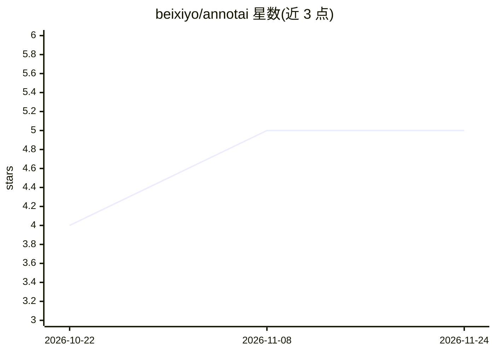

# beixiyo/annotai

⭐ — · [GitHub]() · 个人维护 · 中文 README

**给开发者把页面元素标注成 AI 可用源码上下文的 Vite 插件**

以 Vite 构建时插件形式运行（仅开发环境，生产构建零注入）：在浏览器中选取页面元素，经 sourcemap 精确到行列地收集对应源码片段，连同提问一起导出为 Markdown 供粘贴给 AI；Alt+Shift 点击可跳转到编辑器中的源码位置，默认支持 Neovim socket 自动发现并回退到 launch-ide。支持 React/Vue/Solid，提供 hover 源码预览、CSS 变量主题定制、自定义剪贴板格式化与 Node 侧 onCopy 钩子。

## 筛选速览

| 维度 | 判定 | 备注 |
|---|---|---|
| AI 角色 | `ai-enhanced` | 去掉 AI 部分产品仍成立 |
| 许可风险 | `none` | — |
| 部署形态 | `library` | 以包/库形式分发 |
| 模型依赖 | — | README 未给出锁定关系 |
| 硬件要求 | — | 无带数字的原话,不猜 |
| 安装摩擦 | `low` | 无编译、无系统依赖或容器化 |
| 成熟度 | — | 结构信号不足 |

## 能力要点

- sourcemap 精确到行/列的元素→源码定位
- 导出含路径、行列与片段的 AI-ready Markdown
- Alt+Shift 跳转编辑器，Neovim socket 自动发现
- React/Vue/Solid 三框架 transform 支持

## 适用场景

- 向 AI 提问 UI 问题时附带精确源码上下文
- 浏览器中快速跳转到元素对应的源码位置
- 把选中元素的标注通过 onCopy 钩子转发给 agent 或自建服务

## 场景标签

 · 领域:开发者工具/前端工程化

## 证据(README 行号)

> L19: Show AI exactly which element you're talking about: select elements in the browser, collect precise source context 
> L55: The toolbar injects itself — no components to mount. Production builds skip injection and never start the source se

## 星数曲线

2026-10-22 4 → 2026-11-24 5（+1）

---
*卡片 v1 · prompt 1.4 · 生成 2026-11-21 · 置信度 high · 依据 README sha `5196752cabe6` · [字段定义](../../DATASET.md)*
