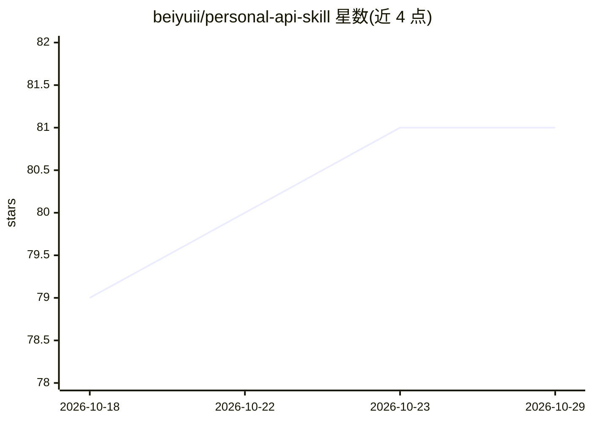

# beiyuii/personal-api-skill

⭐ 81 · Shell · MIT · 推送 2026-05-15 · [GitHub](https://github.com/beiyuii/personal-api-skill) · [官网](https://github.com/NousResearch/hermes-agent.git) · 个人维护 · 中文 README

**把 Obsidian 仓库变成 AI 代理可读的个人身份层**

通过 setup.sh 在 Obsidian vault 中生成一套纯 markdown 契约文件：ME.md 身份契约、AGENT.md 行为契约、CLAUDE.md/AGENTS.md 等针对各 agent 运行时的轻量适配文件，以及 Knowledge Palace v2 知识生产目录结构（30.knowledge/ 等，可用 --minimal 跳过）。任何能读文件的 AI 代理（Claude Code、Codex/OpenAI Agents、Cursor、ChatGPT、Gemini）通过标准提示词读取这些文件获取用户背景与协作规则。脚本只创建缺失文件、保留已有文件，并安装 vault 级 .gitignore 保护隐私。

## 筛选速览

| 维度 | 判定 | 备注 |
|---|---|---|
| AI 角色 | `ai-ecosystem` | LLM/agent 周边工具 |
| 许可风险 | `permissive` | MIT |
| 部署形态 | `None` |  |
| 模型依赖 | — | README 未给出锁定关系 |
| 硬件要求 | — | 无带数字的原话,不猜 |
| 安装摩擦 | `low` | 无编译、无系统依赖或容器化 |
| 成熟度 | — | 结构信号不足 |

## 能力要点

- ME.md + AGENTS.md + 多运行时适配文件的身份/行为契约
- 双轨道结构：身份档案只读建议，知识生产轨道按方法论编译维护
- capture→research→notes→outputs→archive 的 Knowledge Palace v2 生命周期
- 脚本保留已有文件，仅创建缺失文件；可选 --minimal 轻量模式

## 适用场景

- 让每个 AI 工具开箱即知我的背景与协作偏好，免去重复自我介绍
- 按固定方法论把 Obsidian 仓库组织为可维护的第二大脑
- 为 Claude Code / Codex 等 agent 提供统一的个人上下文入口

## 场景标签

`知识库管理` `提示工程` · 领域:Agent 开发

## 证据(README 行号)

> L3: > **Turn your Obsidian vault into an AI identity layer.** Any AI agent reads `ME.md` + `AGENT.md` and immediately ge
> L19: - `CLAUDE.md` / `AGENTS.md` — thin adapter files for agent runtimes.
> L95: The protocol is plain markdown, so any AI agent that can read files can use it.

## 星数曲线

2026-10-18 79 → 2026-10-29 81（+2）

---
*卡片 v1 · prompt 1.4 · 生成 2026-10-24 · 置信度 high · 依据 README sha `f9e08fdf032d` · [字段定义](../../DATASET.md)*
