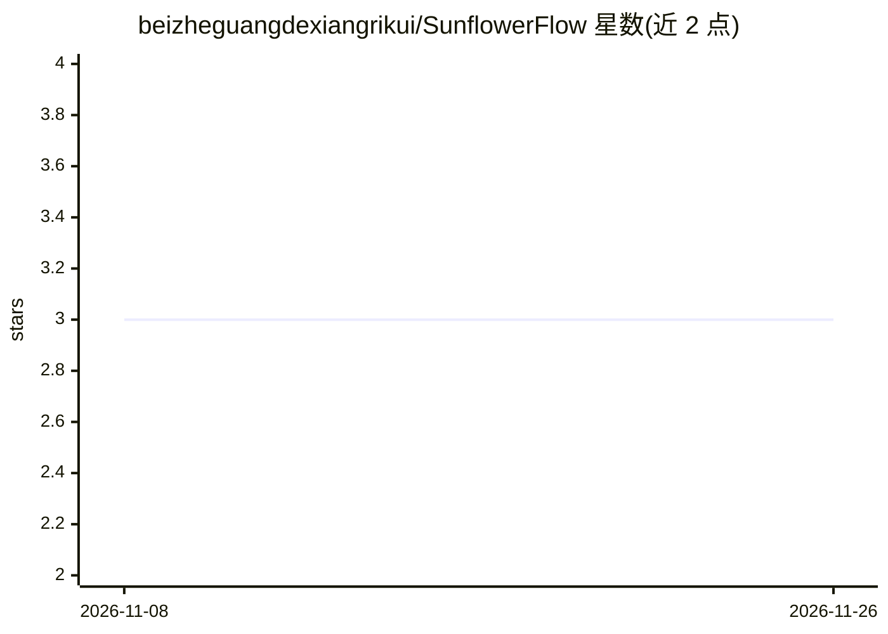

# beizheguangdexiangrikui/SunflowerFlow

⭐ 3 · 推送 2026-11-09 · [GitHub](https://github.com/beizheguangdexiangrikui/SunflowerFlow) · 个人维护 · 中文 README

**Windows 桌面端 AI 社交机器人：接 QQ/微信/抖音/B站按人设回话**

运行在自己电脑上的 AI 社交机器人，接入 QQ、微信、抖音、B站四个平台，按可编辑人格在群里回话，支持画图、生视频、语音合成与长期记忆。核心机制：三层模型链（主模型+备用链+全局兜底）自动降级、全局人格+渠道级覆写、五种触发模式与四级 NSFW 开关。自带 12 个管理页的浏览器控制台；安装包内置 Python 3.12 运行时，数据全部留在本机 data/ 目录。部分平台需自备凭据或登录态。

## 筛选速览

| 维度 | 判定 | 备注 |
|---|---|---|
| AI 角色 | `ai-native` | 本体是模型或模型工具 |
| 许可风险 | `none` | — |
| 部署形态 | `desktop` | 安装包/桌面程序 |
| 模型依赖 | local-ok | 支持本地模型 |
| 硬件要求 | — | 无带数字的原话,不猜 |
| 安装摩擦 | `low` | 无编译、无系统依赖或容器化 |
| 成熟度 | — | 结构信号不足 |

## 能力要点

- 多供应商模型管理：主模型+备用链+全局兜底，被拒答自动降级
- 出图/生视频/语音合成（ComfyUI 本机出图或云端 API，Edge TTS 音色可克隆）
- 全局人格+群/私聊独立覆写，五种触发模式与概率项细调
- 浏览器控制台 12 个管理页，改动即时生效，含看门狗与备份回滚

## 适用场景

- 给自己的 QQ/微信账号配一个按人设自动回话的机器人
- 不同群用不同模型与性格，控制 token 用量
- 在群聊里让它画图、发语音、看图评论
- 数据不出本机地跑一个多平台社交通道

## 场景标签

`聊天机器人` `图像生成` `语音合成` · 领域:对话与助手

## 证据(README 行号)

> L3: **一个跑在自己电脑上的 AI 社交机器人。**
> L8: 接 QQ / 微信 / 抖音 / B站；能画图、能生视频、能发语音；
> L42: 这一版把判断权交给模型自己——它拿到的是一张真实的「现在是什么情况」，而不是一串关键词。

## 星数曲线

2026-11-08 3 → 2026-11-26 3（+0）

---
*卡片 v1 · prompt 1.4 · 生成 2026-11-22 · 置信度 mid · 依据 README sha `c6f8ba278177` · [字段定义](../../DATASET.md)*
