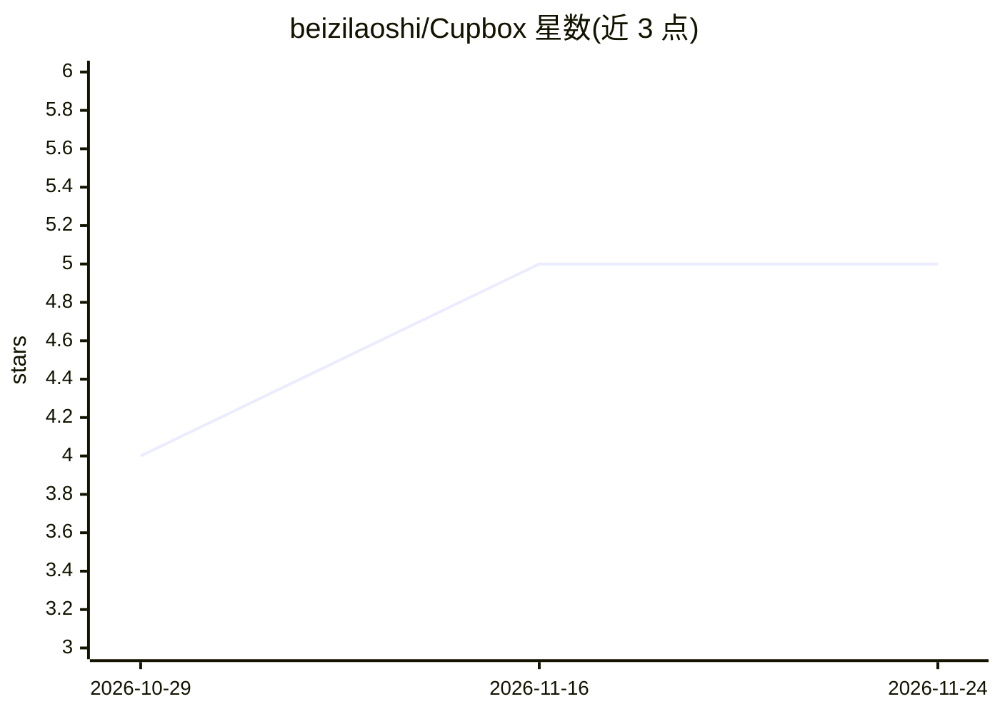

# beizilaoshi/Cupbox

⭐ 5 · TypeScript · NOASSERTION · 推送 2026-11-02 · [GitHub](https://github.com/beizilaoshi/Cupbox) · [官网](https://afdian.com/a/beilaishi) · 组织维护 · 中文 README

**给开发者和 AI 智能体的本地杂活工具箱（CLI+MCP+桌面版）**

面向日常开发杂活的本地工具箱，提供三种入口：面向开发者的 CLI、供 MCP 兼容客户端调用的工具集，以及 Electron 桌面工作台。核心能力覆盖文件整理/重命名/搜索、哈希/时间戳/编解码/CSV-JSON 转换、图片混淆还原、OCR、剪贴板与进程管理。内置 AI 问答与多轮 Agent 引擎（OpenAI 兼容/Anthropic 双协议），配三层记忆与上下文压缩；对文件变更默认 dry-run、命令执行走白名单。代码 MIT 许可，美术与音频资源及 IP 形象不在许可范围内。

## 筛选速览

| 维度 | 判定 | 备注 |
|---|---|---|
| AI 角色 | `ai-enhanced` | 去掉 AI 部分产品仍成立 |
| 许可风险 | `none` | NOASSERTION |
| 部署形态 | `desktop` | 安装包/桌面程序 |
| 模型依赖 | local-ok | 支持本地模型 |
| 硬件要求 | — | 无带数字的原话,不猜 |
| 安装摩擦 | `low` | 无编译、无系统依赖或容器化 |
| 成熟度 | — | 结构信号不足 |

## 能力要点

- 一套核心能力三入口复用：CLI 21 项、MCP 同套工具、桌面工具箱 121 项
- AI Agent 循环可调用本地 14 个工具，rename/organize 永远 dry-run、run 命令白名单强制
- 三层本机记忆（用户画像/长期事实/项目档案）与超长对话上下文压缩
- Use-It 引擎通过 COM 操作已打开的 PowerPoint/Word/Excel/AutoCAD 与桌面 GUI

## 适用场景

- 把下载目录按类型批量整理，先预览确认再执行
- 让 AI 智能体通过 MCP 在授权范围内帮忙做本地文件操作
- 桌面对话工作台里跑 Agent 任务并查看工具调用轨迹
- 批量转换时间戳、编解码、CSV/JSON 处理等终端杂活

## 场景标签

`OCR` `AI 助手` `Agent 记忆` · 领域:Agent 开发

## 证据(README 行号)

> L64: - **CLI：** 面向开发者，适合手动操作、终端工作流和脚本自动化。
> L66: - **桌面版：** Electron 工作台，普通任务继续原会话，高级任务在主窗口内嵌原生 AI 引擎；工具调用、提问、审批、执行轨迹和任务恢复都在同一界面完成。
> L427: Cupbox 的一个重要目标，是让 AI 不仅能回答问题，还能在受控范围内调用实际工具。

## 星数曲线

2026-10-29 4 → 2026-11-24 5（+1）

---
*卡片 v1 · prompt 1.4 · 生成 2026-11-21 · 置信度 high · 依据 README sha `b4e7e061feda` · [字段定义](../../DATASET.md)*
