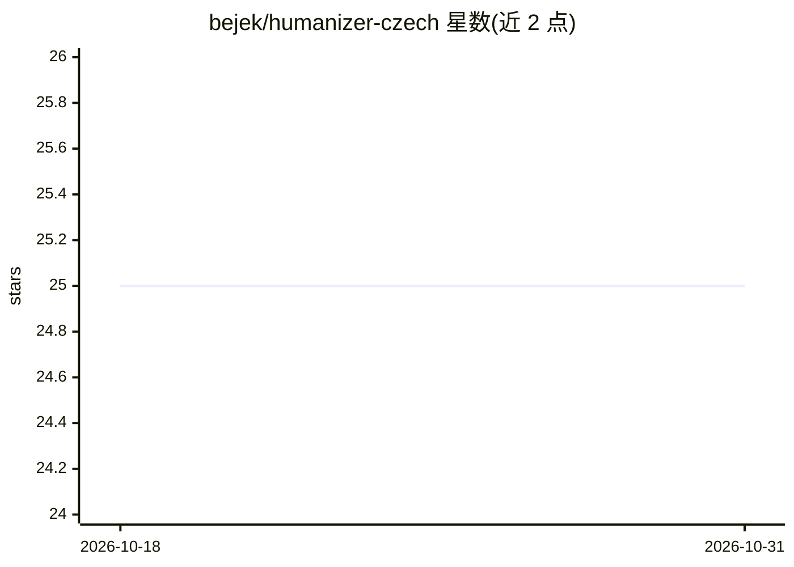

# bejek/humanizer-czech

⭐ 25 · MIT · 推送 2026-04-30 · [GitHub](https://github.com/bejek/humanizer-czech) · 个人维护

**捷克语 AI 文本人性化 skill：检测并改写 27 种 AI 写作痕迹**

面向捷克语用户的 humanizer 技能包：以 SKILL.md/PROMPT.md 形式提供，识别 27 种捷克语 AI 生成文本的典型模式（AI 套话、英文语序、破折号滥用、名义化等），通过双通道机制（改写→自检→再修正）重写文本，并支持学术、正式、友好、对话 4 种输出风格。安装方式为 git clone 到 Claude Code skills 目录，或在 claude.ai 上传 SKILL.md，也可将 PROMPT.md 内容作为系统提示词用于 ChatGPT、Gemini 等任意 LLM。MIT 许可。

## 筛选速览

| 维度 | 判定 | 备注 |
|---|---|---|
| AI 角色 | `ai-native` | 本体是模型或模型工具 |
| 许可风险 | `permissive` | MIT |
| 部署形态 | `None` |  |
| 模型依赖 | locked-api |  |
| 硬件要求 | — | 无带数字的原话,不猜 |
| 安装摩擦 | `low` | 无编译、无系统依赖或容器化 |
| 成熟度 | — | 结构信号不足 |

## 能力要点

- 检测 27 种捷克语特有的 AI 写作模式
- 双通道系统：改写后自检并再次修正
- 4 种输出风格（学术/正式/友好/对话）
- 可作为 Claude Code skill 或任意 LLM 的系统提示词使用

## 适用场景

- 把 AI 生成的捷克语文本改写成更自然的表达
- 学术或商务写作中选择对应风格去除 AI 痕迹
- 在其他 LLM（ChatGPT/Gemini）中作为系统提示词使用

## 场景标签

`AI 写作` `提示工程` · 领域:Agent 开发

## 证据(README 行号)

> L10: Pečlivě sestavený humanizer skill zaměřený specificky na český jazyk. Detekuje 27 vzorců typických pro AI-generovan
> L26: - **Dual-pass systém**: přepíše → zkontroluje → opraví znovu

## 星数曲线

2026-10-18 25 → 2026-10-31 25（+0）

---
*卡片 v1 · prompt 1.4 · 生成 2026-10-27 · 置信度 high · 依据 README sha `7c2fbc92ac07` · [字段定义](../../DATASET.md)*
