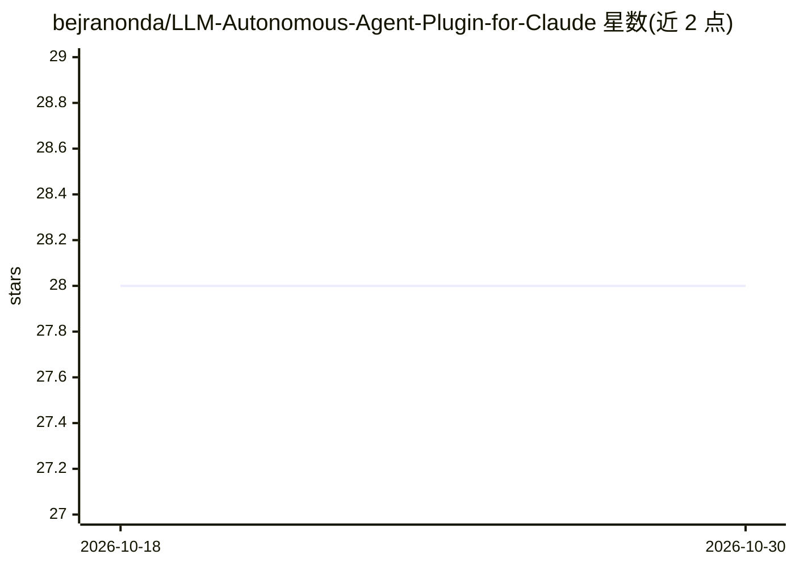

# bejranonda/LLM-Autonomous-Agent-Plugin-for-Claude

⭐ 28 · Python · 推送 2026-06-21 · [GitHub](https://github.com/bejranonda/LLM-Autonomous-Agent-Plugin-for-Claude) · [官网](https://github.com/bejranonda/LLM-Autonomous-Agent-Plugin-for-Claude#readme) · 个人维护

**Claude Code 自治代理插件：36 子代理分层协作与持续学习**

面向 Claude Code 用户的代理插件：以 4 层架构组织 36 个专门子代理（战略分析、决策、执行、验证），提供 27 个技能、10 类共 41 个斜杠命令，覆盖从实现（/dev:auto）到发布（/dev:release）的工作流。机制上包含跨任务的模式学习与模式存储、11 项 KPI 的实时仪表盘（5 个分页、JSON/CSV/PDF 导出）、覆盖 15+ 语言 40+ linter 的自动修复与 OWASP Top 10 安全检查，声明 100% 本地处理。以 Claude Code 插件形式分发，支持 marketplace 安装，另带 bin/ 目录 CLI 可执行脚本。

## 筛选速览

| 维度 | 判定 | 备注 |
|---|---|---|
| AI 角色 | `ai-ecosystem` | LLM/agent 周边工具 |
| 许可风险 | `none` | — |
| 部署形态 | `self-host` | docker 或自建部署 |
| 模型依赖 | — | README 未给出锁定关系 |
| 硬件要求 | — | 无带数字的原话,不猜 |
| 安装摩擦 | `low` | 无编译、无系统依赖或容器化 |
| 成熟度 | — | 结构信号不足 |

## 能力要点

- 4 层架构 36 子代理（分析/决策/执行/验证）协作
- 模式学习与预测性技能选择，跨任务持续改进
- 11 项 KPI 实时仪表盘，支持 JSON/CSV/PDF 导出
- 24 种自动修复模式与 OWASP Top 10 安全检查

## 适用场景

- 用斜杠命令从需求实现到自动发布完整开发流程
- 通过仪表盘查看代理性能、成本与质量指标
- 自动检测并修复多语言代码问题与安全漏洞

## 场景标签

`多智能体` `编码 Agent` `代码审查` · 领域:Agent 开发

## 证据(README 行号)

> L1: # 🚀 Autonomous Agent for Claude Code v8.4.5
> L43: A **paradigm shift** from static tools to living intelligence with **36 specialized agents** across 4 collaborative
> L151: - **Standards-Compliant Manifests**: plugin.json, all 36 agent files, 41 commands, and 27 skills validated against

## 星数曲线

2026-10-18 28 → 2026-10-30 28（+0）

---
*卡片 v1 · prompt 1.4 · 生成 2026-10-26 · 置信度 mid · 依据 README sha `65349753cb16` · [字段定义](../../DATASET.md)*
