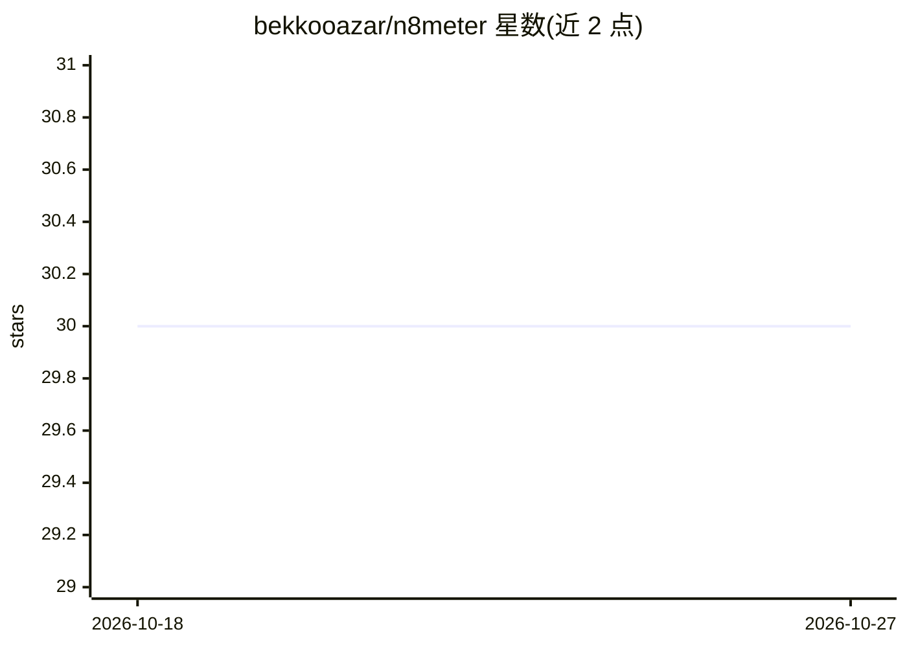

# bekkooazar/n8meter

⭐ 30 · HTML · MIT · 推送 2026-08-13 · [GitHub](https://github.com/bekkooazar/n8meter) · 个人维护

**n8n AI 工作流的本地成本计量面板：按工作流/客户/日展示账单**

自托管的 n8n 用量与成本监控工具：通过 n8n API 轮询执行记录，读取 token 用量并归因到节点与运行，对照每 24 小时更新的 2,500+ 模型价格目录计算费用，按工作流、客户和日期展示。支持预算与告警（Slack 兼容 webhook）、无 API 访问时的 webhook 回退上报。所有数据存于本地 SQLite，不读取提示词与补全内容。限制：按目录牌价计算，为规划数字而非发票，不建模缓存折扣与批量定价；部分 LangChain 节点仅有估算值。

## 筛选速览

| 维度 | 判定 | 备注 |
|---|---|---|
| AI 角色 | `ai-ecosystem` | LLM/agent 周边工具 |
| 许可风险 | `permissive` | MIT |
| 部署形态 | `self-host` | docker 或自建部署 |
| 模型依赖 | — | README 未给出锁定关系 |
| 硬件要求 | — | 无带数字的原话,不猜 |
| 安装摩擦 | `low` | 无编译、无系统依赖或容器化 |
| 成熟度 | — | 结构信号不足 |

## 能力要点

- token 用量从 n8n 执行记录读取并归因到节点与运行
- 2,500+ 模型价格目录每 24 小时刷新，未收录模型自动重定价
- 全局/工作流/客户级预算告警（Slack 兼容 webhook）
- 数据仅存本地 SQLite，无遥测

## 适用场景

- 我在自己机器上查看每个 n8n 工作流的 AI 成本
- 按客户分组拆分 AI 支出并设置预算告警
- n8n Cloud 免费版无 API 时用 webhook 上报用量

## 场景标签

`LLM 可观测性` · 领域:评测与运维

## 证据(README 行号)

> L3: **Know exactly what your n8n AI workflows cost.** n8meter reads token usage out of your n8n executions, prices it ag
> L31: - **Per-workflow metering** — token usage is pulled from your executions and attributed down to the node and run. W

## 星数曲线

2026-10-18 30 → 2026-10-27 30（+0）

---
*卡片 v1 · prompt 1.4 · 生成 2026-10-26 · 置信度 high · 依据 README sha `fc87e0f0de32` · [字段定义](../../DATASET.md)*
