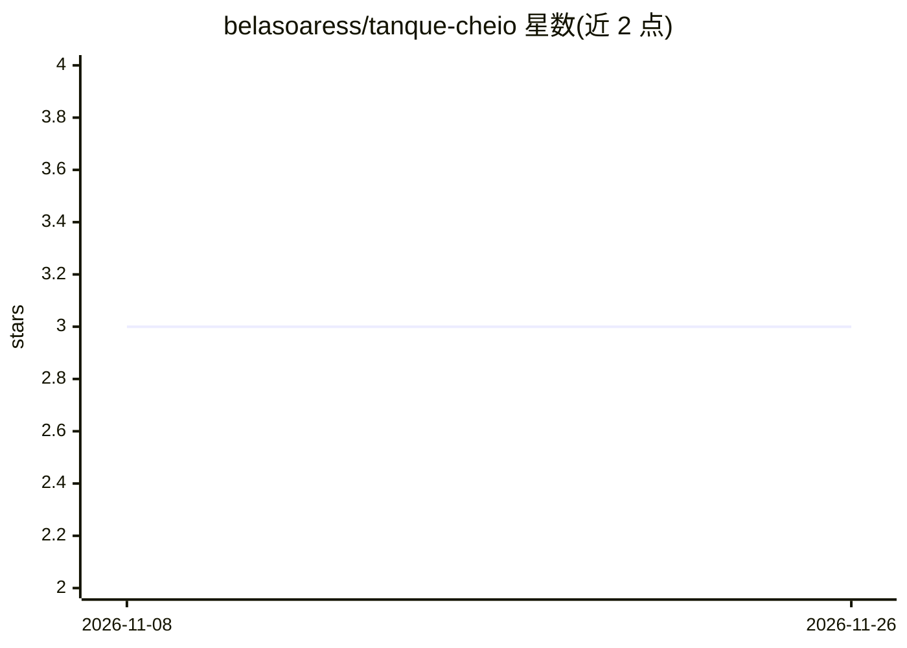

# belasoaress/tanque-cheio

⭐ 3 · Python · MIT · 推送 2026-10-30 · [GitHub](https://github.com/belasoaress/tanque-cheio) · 个人维护

**葡萄牙语自然语言查询巴西 ANP 燃油价格的 text-to-SQL 项目**

围绕巴西 ANP 燃油价格开放数据构建的葡萄牙语 text-to-SQL 工程：接收葡语提问，用 QLoRA 微调的 Qwen2.5-Coder-1.5B 生成 SQL，经 guardrail 在 DuckDB 快照上安全执行并返回带 SQL 的表格。附 150 题人工评审测试集、置信区间与 McNemar 配对检验、CI 可复算的报告流程；训练模板生成含泄漏过滤。推理与训练跑在 Kaggle 免费 T4 笔记本；Gradio demo 提供约 0.9 GB 的 GGUF Q4_K_M 量化模型，可在 4 核 CPU 运行（单问 6–21 秒）。运行需 uv。

## 筛选速览

| 维度 | 判定 | 备注 |
|---|---|---|
| AI 角色 | `ai-native` | 本体是模型或模型工具 |
| 许可风险 | `permissive` | MIT |
| 部署形态 | `None` |  |
| 模型依赖 | — | README 未给出锁定关系 |
| 硬件要求 | — | 无带数字的原话,不猜 |
| 安装摩擦 | `low` | 无编译、无系统依赖或容器化 |
| 成熟度 | — | 结构信号不足 |

## 能力要点

- QLoRA 微调 Qwen2.5-Coder-1.5B 生成 SQL，经 guardrail 在 DuckDB 上安全执行
- 150 题人工评审测试集，报告含 95% CI、McNemar 配对检验，CI 从保存的预测重算
- 训练数据由 57 个意图模板生成并带泄漏过滤，Kaggle 免费 T4 训练
- GGUF Q4_K_M 量化（~0.9 GB）的 Gradio demo 可在 CPU 运行

## 适用场景

- 用葡语自然语言查询巴西 ANP 燃油价格数据并得到表格结果
- 复现小型模型 QLoRA 微调与统计化评测流程
- 在 CPU 上本地运行量化 text-to-SQL demo

## 场景标签

`数据分析` `模型评测` `微调` `模型量化` · 领域:效率与自动化

## 证据(README 行号)

> L7: Portuguese text-to-SQL over Brazil's ANP fuel price data (DuckDB), with Qwen2.5-Coder-1.5B fine-tuned via QLoRA on K
> L11: O tanque-cheio recebe uma pergunta em português sobre preços de combustíveis no Brasil
> L139: O modelo final (ft-v2), fundido e quantizado em GGUF Q4_K_M (~0,9 GB), roda em CPU, sem

## 星数曲线

2026-11-08 3 → 2026-11-26 3（+0）

---
*卡片 v1 · prompt 1.4 · 生成 2026-11-22 · 置信度 high · 依据 README sha `9a724f6c86bd` · [字段定义](../../DATASET.md)*
