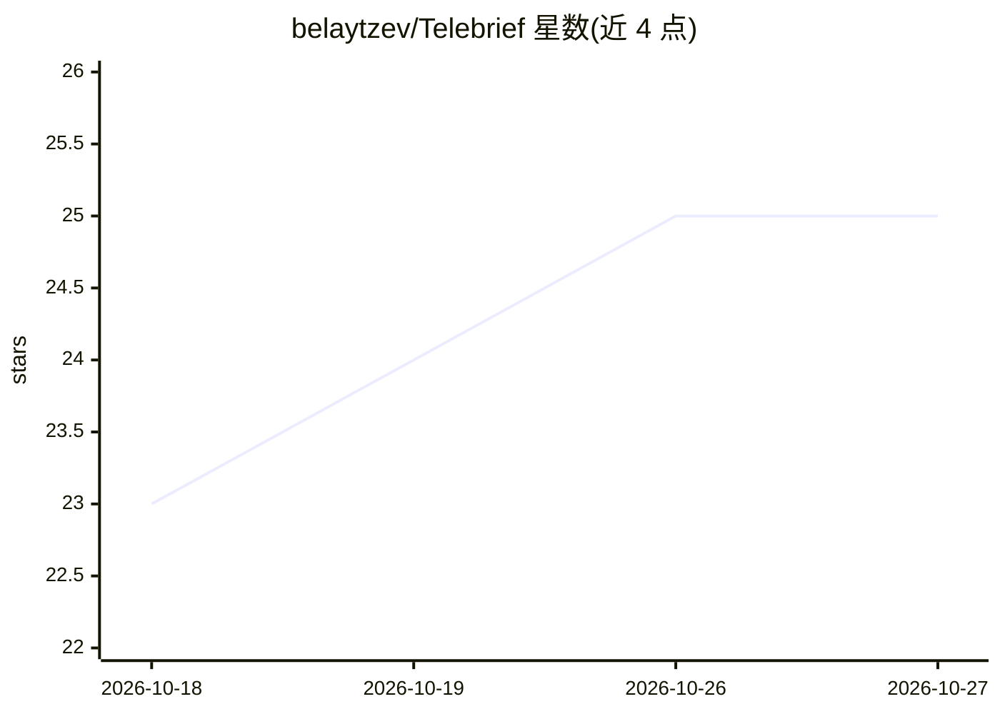

# belaytzev/Telebrief

⭐ 25 · Python · MIT · 推送 2026-10-26 · [GitHub](https://github.com/belaytzev/Telebrief) · [官网](https://telebrief.ti1orn.com) · 个人维护

**自部署 Telegram 频道 AI 摘要机器人：定时生成分组日报**

运行在用户自己服务器上的单用户服务：读取 Telegram 公开/私有频道与私聊消息，调用 OpenAI、Anthropic 或本地 Ollama 模型生成摘要，通过用户自建的 Telegram bot 按日/周定时推送摘要，可按频道或自定义主题分组，支持跨频道去重与 Markdown 格式输出。会话、API key 与消息保留在本地。安装通过 Docker 运行 setup 向导完成，可选 SQLite/PostgreSQL 持久化消息，还提供可选 MCP 端点供 AI agent 读取摘要。过滤链、提示词模板与存储后端均可通过 config.yaml 扩展替换。

## 筛选速览

| 维度 | 判定 | 备注 |
|---|---|---|
| AI 角色 | `ai-native` | 本体是模型或模型工具 |
| 许可风险 | `permissive` | MIT |
| 部署形态 | `self-host` | docker 或自建部署 |
| 模型依赖 | local-ok | 支持本地模型 |
| 硬件要求 | — | 无带数字的原话,不猜 |
| 安装摩擦 | `low` | 无编译、无系统依赖或容器化 |
| 成熟度 | — | 结构信号不足 |

## 能力要点

- 支持 OpenAI/Anthropic/本地 Ollama 三类摘要提供方
- 按频道或自定义主题分组，跨频道去重（dedup_topics）
- Docker setup 向导生成配置并登录 Telegram，一键 docker compose 启动
- 可选 MCP 端点向 AI agent 提供摘要，过滤链/提示词/存储后端可扩展

## 适用场景

- 订阅多个 Telegram 频道，每天收到一份 AI 汇总的日报
- 用本地 Ollama 模型离线生成摘要，数据不出自己的服务器
- 让 Claude 等 AI agent 通过 MCP 端点读取 Telegram 摘要

## 场景标签

`AI 写作` · 领域:内容生成

## 证据(README 行号)

> L14:  Telebrief reads your Telegram channels, in any language, summarizes them with OpenAI, Anthropic or a local Ollama 
> L24: - Summarizes with OpenAI (including GPT-6 Luna, Sol and Astra), Anthropic, or a local Ollama model.

## 星数曲线

2026-10-18 23 → 2026-10-27 25（+2）

---
*卡片 v1 · prompt 1.4 · 生成 2026-10-27 · 置信度 high · 依据 README sha `8fefc5e7e87b` · [字段定义](../../DATASET.md)*
