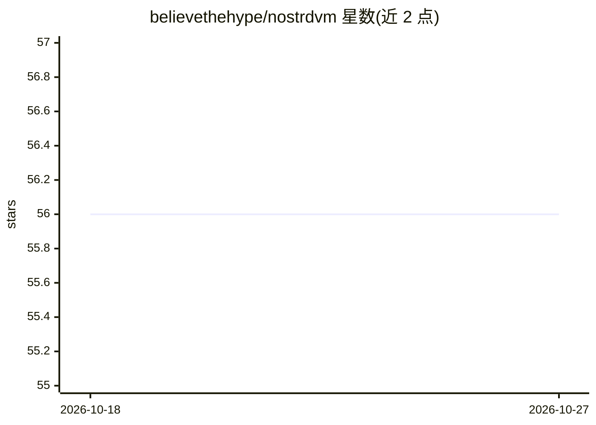

# believethehype/nostrdvm

⭐ 56 · Python · MIT · 推送 2026-09-12 · [GitHub](https://github.com/believethehype/nostrdvm) · 个人维护

**构建与运行 Nostr NIP90 数据售货机（DVM）的 Python 框架**

面向 Nostr 协议开发者的框架，用 Python 构建或运行 NIP90 Data Vending Machine：内置各类任务示例（含可选的 OpenAI 图像任务），支持通过接口添加新任务，默认运行 bot 使 DVM 可由普通社交客户端控制。集成了 LNbits 钱包与闪电地址的自动管理，基于 nostr-sdk（0.45.1），提供 Docker 部署与单元测试套件。项目自述处于 alpha 阶段，接口可能变动；Tor 示例需外部 SOCKS 代理，媒体转换需主机安装 ffmpeg。

## 筛选速览

| 维度 | 判定 | 备注 |
|---|---|---|
| AI 角色 | `ai-ecosystem` | LLM/agent 周边工具 |
| 许可风险 | `permissive` | MIT |
| 部署形态 | `self-host` | docker 或自建部署 |
| 模型依赖 | — | README 未给出锁定关系 |
| 硬件要求 | — | 无带数字的原话,不猜 |
| 安装摩擦 | `low` | 无编译、无系统依赖或容器化 |
| 成熟度 | `idea` | |

## 能力要点

- 以 tasks 文件夹接口方式添加与扩展现有 DVM 任务
- 通过 LNbits 自动管理钱包与 NIP57 闪电地址
- 默认 bot 使 DVM 可经任意常规社交客户端控制
- 提供离线 SDK 回归测试与 Docker Compose 部署

## 适用场景

- 在 Nostr 网络上搭建按请求提供数据/AI 服务的 DVM
- 通过社交客户端对话方式控制自己的 DVM
- 配合 LNbits 实现 DVM 的闪电网络收款

## 场景标签

`Agent 框架` · 领域:Agent 开发

## 证据(README 行号)

> L3: This framework provides a way to easily build and/or run `Nostr NIP90 DVMs in Python`.
> L18: In each task component DVM examples are already prepared. Feel free to play along with the existing ones.

## 星数曲线

2026-10-18 56 → 2026-10-27 56（+0）

---
*卡片 v1 · prompt 1.4 · 生成 2026-10-24 · 置信度 mid · 依据 README sha `23a781a5e4db` · [字段定义](../../DATASET.md)*
