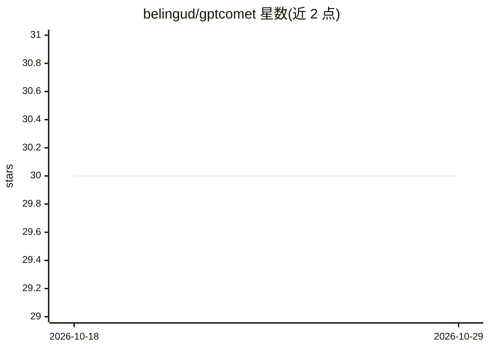

# belingud/gptcomet

⭐ 30 · Go · MIT · 推送 2026-10-28 · [GitHub](https://github.com/belingud/gptcomet) · 个人维护 · 中文 README

**用 LLM 自动生成 Git/SVN 提交信息并做代码审查的命令行工具**

Go 编写的命令行工具 gmsg，读取代码 diff 后调用大语言模型生成简短或结构化（标题+摘要+详情）的提交信息，并对暂存 diff 输出 AI 代码审查与改进建议。支持 OpenAI、Gemini、Claude/Anthropic、Vertex、Azure、Ollama、Groq、Deepseek、通义千问等 20 余种 provider，也可通过 OpenAI 兼容接口接入 OpenRouter、SiliconFlow 等；提供 gmsg newprovider 交互式配置与 YAML 手动配置，prompt、模型、语言、温度等均可定制。同时兼容 SVN 仓库。

## 筛选速览

| 维度 | 判定 | 备注 |
|---|---|---|
| AI 角色 | `ai-native` | 本体是模型或模型工具 |
| 许可风险 | `permissive` | MIT |
| 部署形态 | `library` | 以包/库形式分发 |
| 模型依赖 | local-ok | 支持本地模型 |
| 硬件要求 | — | 无带数字的原话,不猜 |
| 安装摩擦 | `low` | 无编译、无系统依赖或容器化 |
| 成熟度 | — | 结构信号不足 |

## 能力要点

- 基于 diff 自动生成提交信息（含 rich 模板：标题+摘要+详情）
- AI 代码审查（gmsg review），支持流式输出与管道输入
- 支持 20+ LLM provider，含 Ollama 本地运行与 OpenAI 兼容接口
- 支持 Git 与 SVN，输出语言与 prompt 可定制，支持提交标题翻译

## 适用场景

- 我不想手写 commit message，让 AI 根据 diff 自动生成
- 提交前让 AI 审查暂存代码并获得改进建议
- 团队统一提交信息语言和格式（如中文、rich 模板）

## 场景标签

`代码审查` `AI 写作` · 领域:编码与开发

## 证据(README 行号)

> L28: - **Automatic Commit Message Generation**: GPTComet can generate commit messages based on the changes made in the c
> L29: - **Intelligent Code Review**: Get AI-powered code reviews with actionable feedback and suggestions.
> L34: - **Support for Multiple Providers**: GPTComet supports multiple providers, including OpenAI, Gemini, Claude/Anthro

## 星数曲线

2026-10-18 30 → 2026-10-29 30（+0）

---
*卡片 v1 · prompt 1.4 · 生成 2026-10-26 · 置信度 high · 依据 README sha `8bc9bd354991` · [字段定义](../../DATASET.md)*
