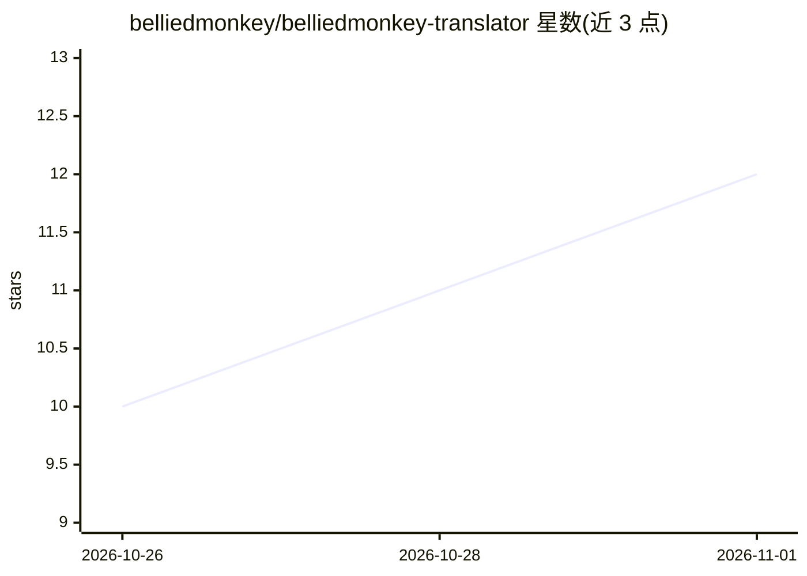

# belliedmonkey/belliedmonkey-translator

⭐ 12 · JavaScript · GPL-3.0 · 推送 2026-10-31 · [GitHub](https://github.com/belliedmonkey/belliedmonkey-translator) · [官网](https://belliedmonkey.cc) · 个人维护 · 中文 README

**双语翻译应用与浏览器扩展：双语网页、双语字幕、实时口译与复习卡片**

面向普通用户的翻译工具，一套代码覆盖 iPhone/iPad/Mac 应用（含 Safari 扩展）与 Chrome、Firefox 扩展。功能包括：段落级双语网页、YouTube/x.com 视频与播客双语字幕、设备播放内容的实时字幕（画中画/悬浮条）、面对面对话实时口译、PDF/Word/图片文档双语阅读，以及把读过的句子生成间隔重复复习卡片。翻译引擎由用户自带 LLM key（任意 OpenAI/Anthropic 兼容端点或免 key Google 通道），项目方服务器不在翻译路径中；1.22.0 起支持 Claude Code/Codex 通过本地 MCP server 驱动。GPL-3.0，从各应用商店安装，源码构建面向贡献者。

## 筛选速览

| 维度 | 判定 | 备注 |
|---|---|---|
| AI 角色 | `ai-native` | 本体是模型或模型工具 |
| 许可风险 | `viral` | GPL-3.0 |
| 部署形态 | `library` | 以包/库形式分发 |
| 模型依赖 | — | README 未给出锁定关系 |
| 硬件要求 | — | 无带数字的原话,不猜 |
| 安装摩擦 | `low` | 无编译、无系统依赖或容器化 |
| 成熟度 | — | 结构信号不足 |

## 能力要点

- 双语网页、双语字幕与实时字幕，一次取稿后按 60 秒滑动窗口提前翻译
- 对话实时口译；iOS 26/macOS 26 语音可在设备端识别
- 读过的句子生成读/听/写三档间隔重复复习卡片
- 自带 LLM key，支持任意 OpenAI/Anthropic 兼容端点，无服务器中转
- Claude Code 与 Codex 可经本地 stdio MCP server 驱动七项翻译动作

## 适用场景

- 双语阅读外文网页，原文译文同屏对照
- 看视频/听播客时显示双语字幕，无字幕内容可用自己的转录 key 生成
- 跨语言面对面对话时做实时口译
- 把阅读中遇到的句子变成复习卡片，用间隔重复记语言

## 场景标签

 · 领域:翻译/语言学习工具

## 证据(README 行号)

> L122: - **Bring your own key** — any OpenAI- or Anthropic-compatible endpoint, or a free Google channel with no key
> L129: - **Agent plugins (1.22.0)** — Claude Code and Codex can drive the translator through a local MCP server (stdio). 

## 星数曲线

2026-10-26 10 → 2026-11-01 12（+2）

---
*卡片 v1 · prompt 1.4 · 生成 2026-11-01 · 置信度 mid · 依据 README sha `84c66f46d9cf` · [字段定义](../../DATASET.md)*
