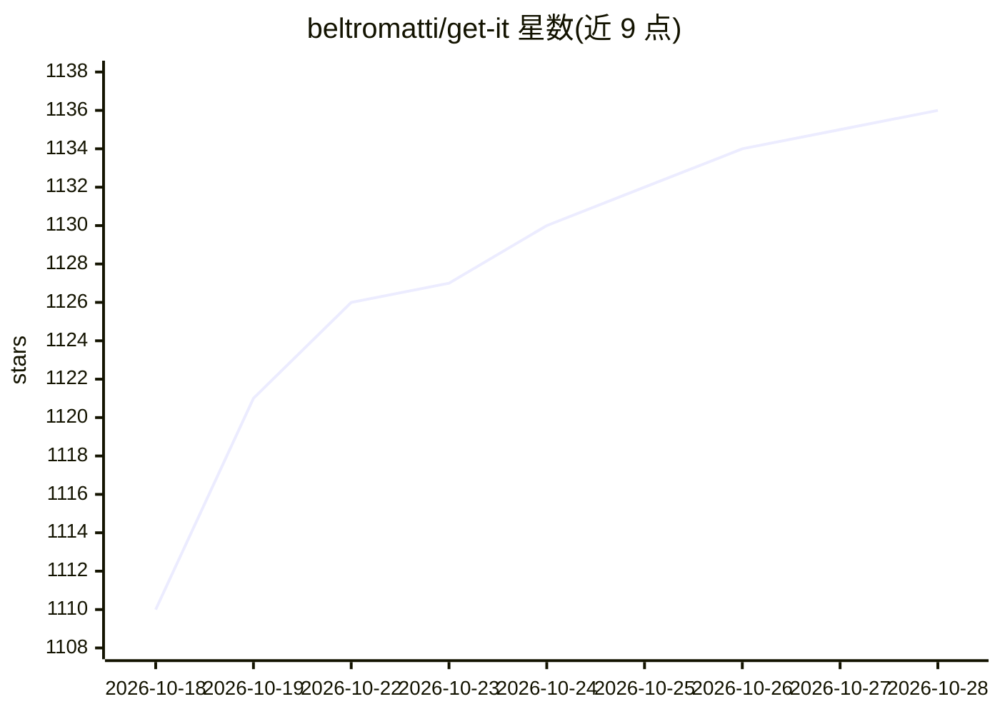

# beltromatti/get-it

⭐ 1,136 · JavaScript · Apache-2.0 · 推送 2026-06-29 · [GitHub](https://github.com/beltromatti/get-it) · [官网](https://getit.noesisai.it) · 组织维护

**把 PDF 变成掌握度地图的桌面学习伴侣应用**

面向学生的 Electron 桌面应用：读取文本型 PDF 或 Markdown，概念检测 agent 在页面植入可视化标签（Three.js 3D、Canvas 动画、KaTeX 公式、绘图、引文），并自动构建 6-25 节点的知识图谱。四种学习工具（对话、闪卡、测验、费曼）记录学习日志，评估 agent 按记忆/理解/结构/应用四轴更新各概念 0-100 分。自带 AI 引擎无服务器：用户以自己的账户或 API key 登录 OpenAI Codex、Anthropic Claude、Google Gemini 或任意 OpenAI 兼容端点（含 Ollama 本地模型），文档与日志仅存本机。提供 macOS/Windows/Linux 安装包，macOS 版已签名公证，Windows 版未签名会触发 SmartScreen 警告。GDG AI Hack 2026 米兰 24 小时作品加后续打磨。

## 筛选速览

| 维度 | 判定 | 备注 |
|---|---|---|
| AI 角色 | `ai-native` | 本体是模型或模型工具 |
| 许可风险 | `permissive` | Apache-2.0 |
| 部署形态 | `desktop` | 安装包/桌面程序 |
| 模型依赖 | local-ok | 支持本地模型 |
| 硬件要求 | — | 无带数字的原话,不猜 |
| 安装摩擦 | `low` | 无编译、无系统依赖或容器化 |
| 成熟度 | `idea` | |

## 能力要点

- 概念检测 agent 在 PDF 页面植入可视化标签（3D/动画/公式/图表/引文）
- 自动构建 6-25 节点知识图谱，四轴掌握度评分（记忆/理解/结构/应用，0-100）
- BYO AI：支持 Codex/Claude/Gemini 账户登录或任意 OpenAI 兼容端点，含 Ollama 本地模型
- 四种学习工具（对话/闪卡/测验/费曼）共享一份本地学习日志

## 适用场景

- 用自己的 AI 订阅把教材 PDF 变成可视化概念地图
- 通过闪卡、测验和费曼式讲解检验并记录对每个概念的掌握程度
- 在本地模型（Ollama）上离线运行全部 AI 功能，数据不出本机

## 场景标签

`知识图谱` · 领域:知识与检索

## 证据(README 行号)

> L37: 2. **The right pane fills in.** Click a tag and its visualization renders — Three.js for anatomy and molecules, Can
> L47: |💡 **Feynman**|The agent plays a curious eight-year-old. *You* teach. The strongest comprehension signal.|
> L59: - **Pick the engine you already pay for.** Get It. ships with four, side by side: **OpenAI Codex** (your ChatGPT Pl

## 星数曲线

2026-10-18 1,110 → 2026-10-28 1,136（+26）

---
*卡片 v1 · prompt 1.4 · 生成 2026-10-21 · 置信度 high · 依据 README sha `fdda23b7ae8c` · [字段定义](../../DATASET.md)*
