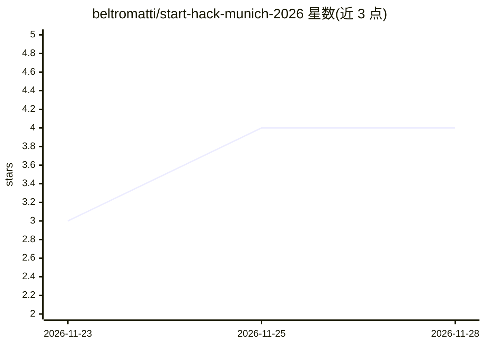

# beltromatti/start-hack-munich-2026

⭐ 4 · Python · 推送 2026-11-22 · [GitHub](https://github.com/beltromatti/start-hack-munich-2026) · [官网](https://hackathon.noesisai.it) · 组织维护

**AI 货代应用：自动完成空运出口询价、报价与订舱跟踪**

面向空运出口业务的 AI 货代代理（Giulia）：读取任意语言的邮件请求及 PDF/扫描件/表格/语音附件，向多家航空公司、运价门户与本地卡车公司比价，生成自然语言报价，客户确认后经门户或邮件订舱，并处理跟踪问询。机制上采用每票货物一个会话的 agent 架构，价格与日期由代码而非模型计算，桌面端展示每个被标记环节及完整操作记录，支持人工随时接管。

## 筛选速览

| 维度 | 判定 | 备注 |
|---|---|---|
| AI 角色 | `ai-native` | 本体是模型或模型工具 |
| 许可风险 | `none` | — |
| 部署形态 | `self-host` | docker 或自建部署 |
| 模型依赖 | — | README 未给出锁定关系 |
| 硬件要求 | — | 无带数字的原话,不猜 |
| 安装摩擦 | `low` | 无编译、无系统依赖或容器化 |
| 成熟度 | — | 结构信号不足 |

## 能力要点

- 多来源附件读取（PDF/扫描件/表格/语音），只追问缺失信息
- 比价覆盖航空公司、运价门户、费率表与卡车公司，含下一重量档
- 价格、总额、日期与收件人由代码计算，模型负责读取与撰写
- 桌面端含 flagged 审计、会话记录与语音入口

## 适用场景

- 空运货代自动化处理客户询价与报价
- 客户确认后自动向航司订舱并回答跟踪问题
- 识别装箱单中的危险品或与附件矛盾的可疑邮件

## 场景标签

`工作流自动化` `文档解析` · 领域:效率与自动化

## 证据(README 行号)

> L5: **An AI forwarder that runs an air export desk on its own.** Giulia reads every request, prices it across airlines,
> L34: - **Answers every request.** Mail in any language, with a packing list in a PDF, a scan, a spreadsheet or a voice
> L89: cp .env.example .env              # an OpenAI key; the 5U team key only for the live challenge

## 星数曲线

2026-11-23 3 → 2026-11-28 4（+1）

---
*卡片 v1 · prompt 1.4 · 生成 2026-11-23 · 置信度 high · 依据 README sha `db663e124d1e` · [字段定义](../../DATASET.md)*
