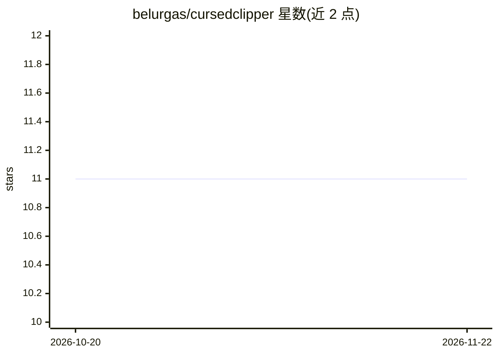

# belurgas/cursedclipper

⭐ 11 · TypeScript · 推送 2026-03-13 · [GitHub](https://github.com/belurgas/cursedclipper) · [官网](https://t.me/cursedclipper) · 个人维护

**面向短视频创作者的 AI 桌面视频剪辑工具**

基于 React 19 + Tauri v2 + Rust 的桌面视频编辑器，面向从长视频生成短视频的创作者工作流：提供基于字幕转写的时间线编辑、AI 建议（钩子、洞察、内容创意）、面向 Shorts/Reels/TikTok/Telegram 的按片段导出配置、字幕与封面工具。媒体处理依赖 ffmpeg/ffprobe/yt-dlp，数据存储用 SQLite。安装需通过 npm 从源码运行，界面支持英语与俄语。

## 筛选速览

| 维度 | 判定 | 备注 |
|---|---|---|
| AI 角色 | `ai-enhanced` | 去掉 AI 部分产品仍成立 |
| 许可风险 | `permissive` | — |
| 部署形态 | `library` | 以包/库形式分发 |
| 模型依赖 | — | README 未给出锁定关系 |
| 硬件要求 | — | 无带数字的原话,不猜 |
| 安装摩擦 | `medium` | 含编译或系统依赖之一 |
| 成熟度 | — | 结构信号不足 |

## 能力要点

- 转写感知的时间线编辑
- AI 建议功能（钩子、洞察、内容创意）
- 针对 Shorts/Reels/TikTok/Telegram 的按片段导出配置
- 字幕与封面工具

## 适用场景

- 把长视频切成适合各短视频平台的片段
- 为短视频生成字幕与封面
- 获取短视频内容的钩子与选题建议

## 场景标签

`图像视频处理` · 领域:感知与多模态

## 证据(README 行号)

> L5:  AI-powered desktop video editing for short-form content.
> L19: - transcript-aware timeline editing
> L20: - AI suggestions (hooks, insights, content ideas)

## 星数曲线

2026-10-20 11 → 2026-11-22 11（+0）

---
*卡片 v1 · prompt 1.4 · 生成 2026-11-18 · 置信度 mid · 依据 README sha `90d1ea7eabd4` · [字段定义](../../DATASET.md)*
