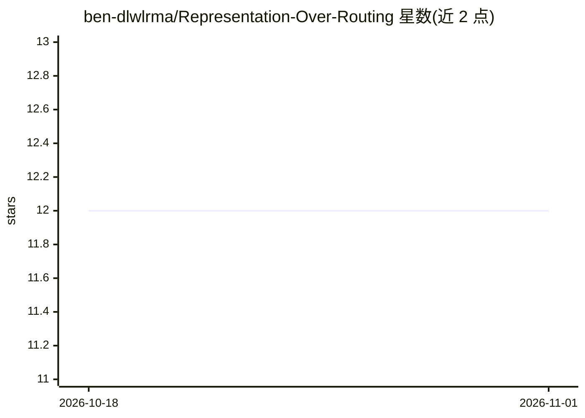

# ben-dlwlrma/Representation-Over-Routing

⭐ 12 · Python · MIT · 推送 2026-06-11 · [GitHub](https://github.com/ben-dlwlrma/Representation-Over-Routing) · [官网]( https://doi.org/10.48550/arXiv.2604.13517) · 个人维护

**多时间尺度 PPO 时间路由病态的诊断研究代码库**

预印论文 "Representation over Routing" 的官方代码库，属于机理诊断研究：在 LunarLander-v2 受控沙盒中比较多时间尺度 PPO 的四种变体（基线 PPO、可微路由、基于误差的路由、Target Decoupling），诊断代理损失中的捷径与路由病理。提供训练/诊断/消融脚本入口，依赖 Python 3.8+ 与 PyTorch，通过 pip 安装 requirements.txt 复现实验；小型预训练 actor 权重随仓库附带并同步分发到 Hugging Face。README 明确声明结果不作为跨环境广泛结论。

## 筛选速览

| 维度 | 判定 | 备注 |
|---|---|---|
| AI 角色 | `ai-native` | 本体是模型或模型工具 |
| 许可风险 | `permissive` | MIT |
| 部署形态 | `library` | 以包/库形式分发 |
| 模型依赖 | — | README 未给出锁定关系 |
| 硬件要求 | — | 无带数字的原话,不猜 |
| 安装摩擦 | `low` | 无编译、无系统依赖或容器化 |
| 成熟度 | — | 结构信号不足 |

## 能力要点

- 四种变体对比：基线 PPO、可微路由、误差路由、Target Decoupling
- gamma=[0.5,0.9,0.99,0.999] 的多时间尺度 critic 设计
- 提供固定 5 个种子的可复现诊断流程与绘图脚本
- 预训练 actor 权重通过 Hugging Face 模型仓库分发

## 适用场景

- 复现论文中不同iable/误差路由诊断实验
- 研究 PPO 代理损失中的多时间尺度路由捷径问题
- 基于受控沙盒检查不同路由策略的行为差异

## 场景标签

`强化学习` · 领域:训练与推理

## 证据(README 行号)

> L13: The project is a mechanistic diagnostic study of temporal routing failure modes in multi-timescale PPO. The experim
> L49: - **Baseline PPO:** single-horizon PPO reference.

## 星数曲线

2026-10-18 12 → 2026-11-01 12（+0）

---
*卡片 v1 · prompt 1.4 · 生成 2026-11-01 · 置信度 mid · 依据 README sha `494d6c648c86` · [字段定义](../../DATASET.md)*
