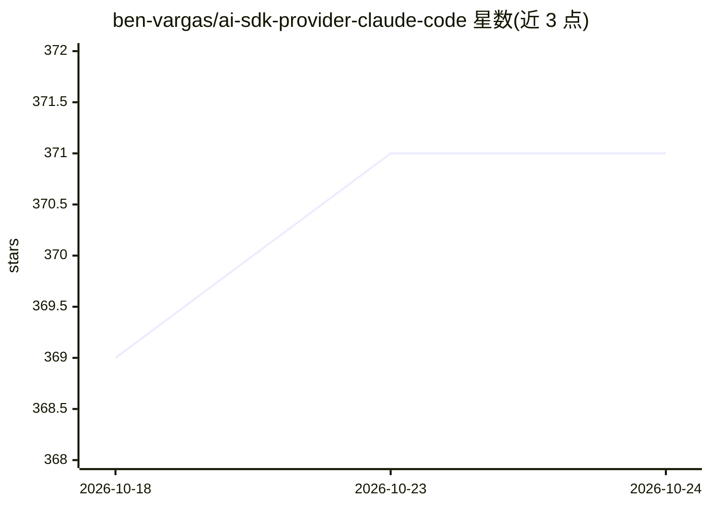

# ben-vargas/ai-sdk-provider-claude-code

⭐ 371 · TypeScript · MIT · 推送 2026-09-28 · [GitHub](https://github.com/ben-vargas/ai-sdk-provider-claude-code) · 个人维护

**让 Vercel AI SDK 通过 Claude Agent SDK 使用 Claude 的社区 provider**

非官方社区 provider 包，把 Claude 接入 Vercel AI SDK：底层通过官方 @anthropic-ai/claude-agent-sdk 与 Claude Code CLI 调用，提供流式输出、多轮对话、原生结构化输出（受约束解码）、AbortSignal、MCP 工具管理与会话管理。4.x 支持 AI SDK v7（需 Node.js ≥22、Zod ^4.1.8、ESM-only），3.x 转入维护支持 v6，另保留 v5/v4 遗留分支。安装需先装并认证 Claude Code CLI，数据经 Claude Agent SDK 发往 Anthropic 服务器。结构化输出存在 CLI 侧限制（部分 JSON Schema 特性回退为纯文本）。

## 筛选速览

| 维度 | 判定 | 备注 |
|---|---|---|
| AI 角色 | `ai-ecosystem` | LLM/agent 周边工具 |
| 许可风险 | `permissive` | MIT |
| 部署形态 | `library` | 以包/库形式分发 |
| 模型依赖 | locked-api |  |
| 硬件要求 | — | 无带数字的原话,不猜 |
| 安装摩擦 | `low` | 无编译、无系统依赖或容器化 |
| 成熟度 | — | 结构信号不足 |

## 能力要点

- 基于官方 @anthropic-ai/claude-agent-sdk 与 Claude Code CLI 接入 Vercel AI SDK
- 流式输出、多轮对话、原生结构化输出（constrained decoding）
- MCP 工具管理与权限、会话创建/恢复/分叉/删除
- 多版本线并行：4.x 对应 AI SDK v7，3.x 维护 v6，含 v5/v4 遗留分支

## 适用场景

- 在已有的 Vercel AI SDK 应用中把 Claude 作为模型提供方接入
- 通过 AI SDK 的统一接口使用 Claude Code 的工具与 MCP 能力
- 构建依赖 Claude Agent SDK 的多轮/结构化输出应用

## 场景标签

`Agent 框架` · 领域:Agent 开发

## 证据(README 行号)

> L12: **ai-sdk-provider-claude-code** lets you use Claude via the Vercel AI SDK through the official `@anthropic-ai/claud
> L249: - 🚀 Vercel AI SDK compatibility

## 星数曲线

2026-10-18 369 → 2026-10-24 371（+2）

---
*卡片 v1 · prompt 1.4 · 生成 2026-10-21 · 置信度 high · 依据 README sha `456d599f6ff6` · [字段定义](../../DATASET.md)*
