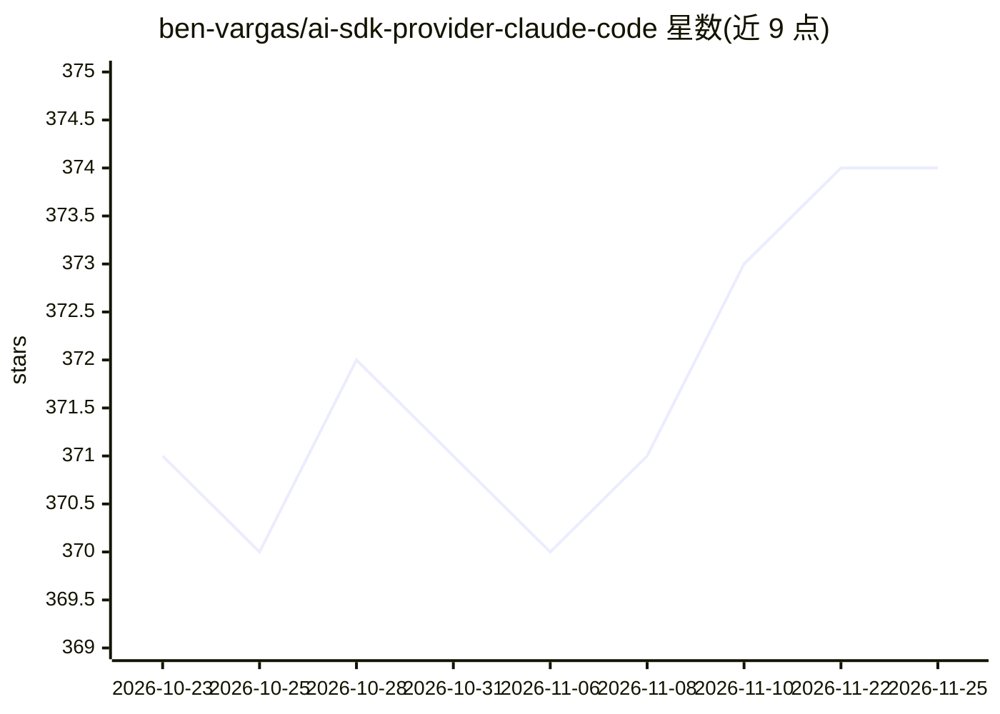

# ben-vargas/ai-sdk-provider-claude-code

⭐ 374 · TypeScript · MIT · 推送 2026-10-25 · [GitHub](https://github.com/ben-vargas/ai-sdk-provider-claude-code) · 个人维护

**开发者用 Vercel AI SDK 接入 Claude Agent SDK 的社区 provider**

将 Claude Agent SDK（底层 Claude Code CLI）封装为 Vercel AI SDK 的社区 provider，支持 streamText/generateText、结构化输出（CLI 按 schema 校验并要求重试）、会话管理与 MCP/回调等能力。版本矩阵覆盖 AI SDK v4–v7，4.x 要求 Node.js ≥22、Zod ^4.1.8、ESM-only。安装需先装并认证 Claude Code CLI，再 npm 安装 provider。声明为非官方社区项目，与 Anthropic/Vercel 无关联；部分 AI SDK v7 接口（files()/skills() 上传、workflow 序列化）未实现。

## 筛选速览

| 维度 | 判定 | 备注 |
|---|---|---|
| AI 角色 | `ai-ecosystem` | LLM/agent 周边工具 |
| 许可风险 | `permissive` | MIT |
| 部署形态 | `library` | 以包/库形式分发 |
| 模型依赖 | locked-api |  |
| 硬件要求 | — | 无带数字的原话,不猜 |
| 安装摩擦 | `low` | 无编译、无系统依赖或容器化 |
| 成熟度 | — | 结构信号不足 |

## 能力要点

- 通过官方 @anthropic-ai/claude-agent-sdk 与 Claude Code CLI 提供 Claude 访问
- 支持原生结构化输出：CLI 校验 schema 并自动要求模型重试
- 版本兼容矩阵覆盖 AI SDK v4 至 v7（分 npm tag 提供）
- 支持会话创建/恢复/分叉/删除与流式结构化输出

## 适用场景

- 在 Vercel AI SDK 项目中以统一接口调用 Claude 模型
- 需要 schema 强约束的结构化生成输出
- CI/CD 与多租户应用中显式管理系统提示与文件系统设置

## 场景标签

`Agent 框架` · 领域:Agent 开发

## 证据(README 行号)

> L12: **ai-sdk-provider-claude-code** lets you use Claude via the Vercel AI SDK through the official `@anthropic-ai/claud
> L101: This release ports the provider to AI SDK v7 / `LanguageModelV4`, adds first-class Claude Agent SDK callback, quer

## 星数曲线

2026-10-23 371 → 2026-11-25 374（+3）

---
*卡片 v1 · prompt 1.4 · 生成 2026-11-25 · 置信度 high · 依据 README sha `cf33ebadf670` · [字段定义](../../DATASET.md)*
