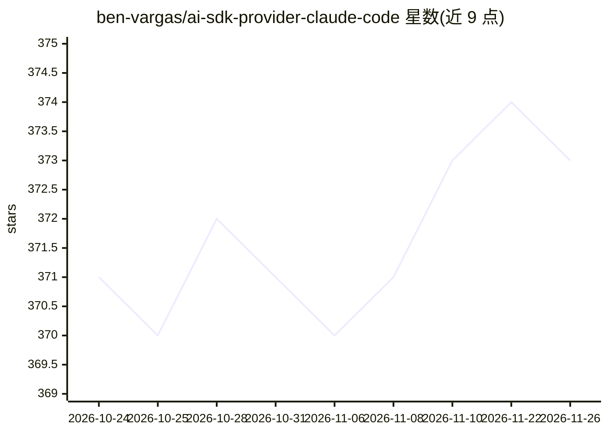

# ben-vargas/ai-sdk-provider-claude-code

⭐ 373 · TypeScript · MIT · 推送 2026-11-25 · [GitHub](https://github.com/ben-vargas/ai-sdk-provider-claude-code) · 个人维护

**让 Vercel AI SDK 通过 Claude Agent SDK 使用 Claude 的社区 provider**

一个连接 Vercel AI SDK 与官方 @anthropic-ai/claude-agent-sdk 及 Claude Code CLI 的社区 provider，声明为非官方、与 Anthropic/Vercel 无隶属关系。按 AI SDK v4–v7 维护多条版本线（4.x 稳定、3.x 维护、更早为 legacy），要求 Node.js ≥22、Zod ^4.1.8，仅支持 ESM。提供会话管理、MCP、回调、图像 part 转发，以及经 CLI outputFormat 的原生结构化输出（含 format 关键词剥离缓解）。安装需先装并认证 Claude Code CLI，再 npm 安装 provider。

## 筛选速览

| 维度 | 判定 | 备注 |
|---|---|---|
| AI 角色 | `ai-ecosystem` | LLM/agent 周边工具 |
| 许可风险 | `permissive` | MIT |
| 部署形态 | `library` | 以包/库形式分发 |
| 模型依赖 | — | README 未给出锁定关系 |
| 硬件要求 | — | 无带数字的原话,不猜 |
| 安装摩擦 | `low` | 无编译、无系统依赖或容器化 |
| 成熟度 | — | 结构信号不足 |

## 能力要点

- 通过官方 @anthropic-ai/claude-agent-sdk 与 Claude Code CLI 接入 Vercel AI SDK
- 按 AI SDK v4–v7 提供多版本支持线与对应 npm tag
- 经 CLI outputFormat 支持原生结构化输出并缓解 schema format 回退问题
- 支持会话管理、MCP、回调与图像 part 转发

## 适用场景

- 在已有 Vercel AI SDK 应用中把模型接入 Claude
- 需要 schema 校验的结构化输出生成任务
- CI/CD 与多租户场景下显式配置系统提示与设置源

## 场景标签

 · 领域:LLM 基础设施/SDK 接入

## 证据(README 行号)

> L12: **ai-sdk-provider-claude-code** lets you use Claude via the Vercel AI SDK through the official `@anthropic-ai/claud
> L60: **This is an unofficial community provider** and is not affiliated with or endorsed by Anthropic or Vercel. By usin

## 星数曲线

2026-10-24 371 → 2026-11-26 373（+2）

---
*卡片 v1 · prompt 1.4 · 生成 2026-11-26 · 置信度 high · 依据 README sha `e400789ed4b0` · [字段定义](../../DATASET.md)*
