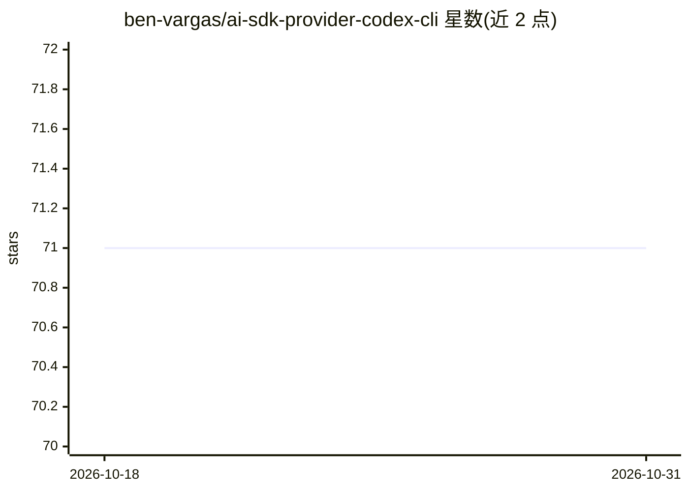

# ben-vargas/ai-sdk-provider-codex-cli

⭐ 71 · TypeScript · MIT · 推送 2026-09-23 · [GitHub](https://github.com/ben-vargas/ai-sdk-provider-codex-cli) · 个人维护

**Vercel AI SDK 社区 Provider：经 Codex CLI 用 ChatGPT 订阅调用模型**

面向开发者的 Vercel AI SDK v7 社区 Provider 包，通过在本地 spawn OpenAI Codex CLI 进程，使 ChatGPT Plus/Pro 订阅（OAuth）或 OPENAI_API_KEY 可作为 AI SDK 的模型后端。提供两种模式：codexExec（每次调用新进程的非交互 exec）与 codexAppServer（持久 JSON-RPC 客户端，支持增量流式与可选有状态线程）。支持 generateText/streamText/generateObject、listModels 模型发现、图像输入、工具流式与 Zod 结构化输出。限制：仅 ESM、Node≥22，依赖 Codex CLI 0.156.x；exec 模式暂无增量流式。

## 筛选速览

| 维度 | 判定 | 备注 |
|---|---|---|
| AI 角色 | `ai-ecosystem` | LLM/agent 周边工具 |
| 许可风险 | `permissive` | MIT |
| 部署形态 | `library` | 以包/库形式分发 |
| 模型依赖 | — | README 未给出锁定关系 |
| 硬件要求 | — | 无带数字的原话,不猜 |
| 安装摩擦 | `low` | 无编译、无系统依赖或容器化 |
| 成熟度 | — | 结构信号不足 |

## 能力要点

- 两种 provider 模式：codexExec（进程/调用）与 codexAppServer（持久 JSON-RPC、增量流式）
- ChatGPT Plus/Pro OAuth 或 OPENAI_API_KEY 认证
- listModels() 模型发现，可用 slug 取决于本机 Codex CLI
- 图像输入（本地 Buffer/URL）与 Zod 结构化对象生成

## 适用场景

- 在 AI SDK 应用中用 ChatGPT 订阅而非 API 计费调用模型
- 对 Codex CLI 的自主工具执行做实时监控
- 需要有状态多轮会话的 Codex 集成（threadId 续接）

## 场景标签

`模型网关` · 领域:Agent 开发

## 证据(README 行号)

> L13: A community provider for Vercel AI SDK v7 that integrates OpenAI's Codex CLI (for example `gpt-6-astra`) using your
> L20: - Works with `generateText`, `streamText`, and `generateObject`
> L115: - AI SDK v7 compatible (native LanguageModelV4 provider spec)

## 星数曲线

2026-10-18 71 → 2026-10-31 71（+0）

---
*卡片 v1 · prompt 1.4 · 生成 2026-10-24 · 置信度 high · 依据 README sha `1377e83c0041` · [字段定义](../../DATASET.md)*
