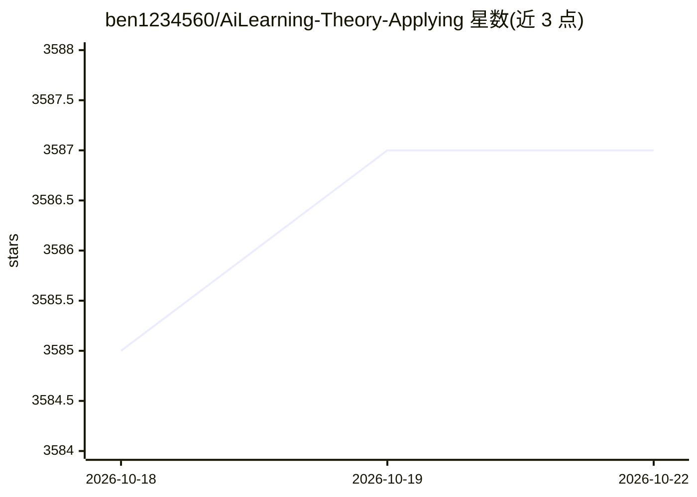

# ben1234560/AiLearning-Theory-Applying

⭐ 3,587 · Jupyter Notebook · MIT · 推送 2026-10-18 · [GitHub](https://github.com/ben1234560/AiLearning-Theory-Applying) · 个人维护 · 中文 README

**AI 理论与应用实战教程库：数学基础到 Transformer/BERT 与竞赛**

面向学习者的 AI 知识仓库，按章节组织：数学基础（微积分、线性代数、概率论、贝叶斯等）、Transformer 网络架构逐章讲解、机器学习与深度学习算法原理推导、BERT 原理解读与中文情感分析实战，以及多个 Kaggle/天池等竞赛优胜解决方案。大量条目附带数据集，作者声明目标是让每一位读者能看懂并复现。内容持续更新，明示不用于商业用途，转载需注明出处。

## 筛选速览

| 维度 | 判定 | 备注 |
|---|---|---|
| AI 角色 | `ai-knowledge` | 知识聚合/清单类 |
| 许可风险 | `permissive` | MIT |
| 部署形态 | `None` |  |
| 模型依赖 | — | README 未给出锁定关系 |
| 硬件要求 | — | 无带数字的原话,不猜 |
| 安装摩擦 | `low` | 无编译、无系统依赖或容器化 |
| 成熟度 | — | 结构信号不足 |

## 能力要点

- 覆盖数学基础、ML、DL、Transformer、BERT 的章节化教程
- 多个竞赛优胜解决方案实战（金融、工业、智慧城市等）
- 大量章节附带数据集，可复现
- BERT 源码解读与中文情感分析项目

## 适用场景

- 系统学习从数学基础到 Transformer/BERT 的 AI 理论
- 通过带数据集的竞赛项目做实战练习
- 参考 Kaggle/天池优胜方案的实现

## 场景标签

`教程课程` · 领域:学习与行业

## 证据(README 行号)

> L3: 快速上手Ai理论及应用实战：基础知识Basic knowledge、机器学习MachineLearning、深度学习DeepLearning2、自然语言处理BERT，持续更新中。含大量注释及数据集，力求每一位能看懂并复现。
> L5: ## 学习章节：

## 星数曲线

2026-10-18 3,585 → 2026-10-22 3,587（+2）

---
*卡片 v1 · prompt 1.4 · 生成 2026-10-20 · 置信度 high · 依据 README sha `66d55e32bd56` · [字段定义](../../DATASET.md)*
