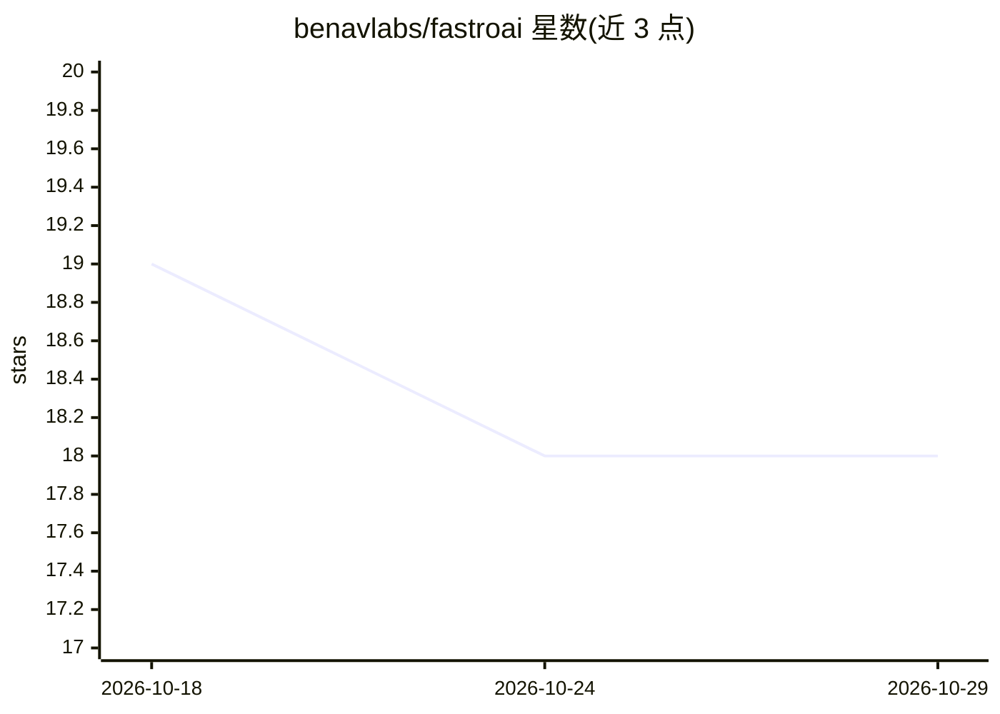

# benavlabs/fastroai

⭐ 18 · Python · MIT · 推送 2026-07-21 · [GitHub](https://github.com/benavlabs/fastroai) · [官网](https://docs.fastro.ai/lib) · 组织维护

**基于 PydanticAI 的轻量 AI 编排库：成本追踪/管道/容错工具**

Python 库，对 PydanticAI 做生产化封装：以微分为单位自动计算成本避免浮点漂移、提供基于 DAG 的多步管道与自动并行化、为 AI 工具增加超时/重试/优雅错误处理，并内置 Logfire 追踪或接入自有观测平台。面向用 PydanticAI 构建 agent 应用的开发者。README 自述为实验性，从内部生产代码抽取，API 版本间可能变更。另有付费的 FastroAI SaaS 模板（auth/Stripe 支付等）另售，不在本库内。MIT 许可。

## 筛选速览

| 维度 | 判定 | 备注 |
|---|---|---|
| AI 角色 | `ai-ecosystem` | LLM/agent 周边工具 |
| 许可风险 | `permissive` | MIT |
| 部署形态 | `library` | 以包/库形式分发 |
| 模型依赖 | — | README 未给出锁定关系 |
| 硬件要求 | — | 无带数字的原话,不猜 |
| 安装摩擦 | `low` | 无编译、无系统依赖或容器化 |
| 成熟度 | `idea` | |

## 能力要点

- 微分为单位的自动成本计算，无浮点漂移
- DAG 管道工作流与自动并行化
- safe_tool 装饰器提供超时、重试与优雅错误处理
- 内置 Logfire 追踪集成

## 适用场景

- 为 PydanticAI agent 添加成本与 token 用量追踪
- 编排多个 AI 步骤组成并行执行的管道
- 让外部服务调用失败时 AI 仍能优雅响应

## 场景标签

`Agent 框架` `LLM 可观测性` · 领域:Agent 开发

## 证据(README 行号)

> L3: ### **Lightweight AI orchestration built on PydanticAI.**
> L16: FastroAI wraps PydanticAI with production essentials: **cost tracking in microcents**, **multi-step pipelines**, an
> L23: - **Pipelines**: DAG-based workflows with automatic parallelization.

## 星数曲线

2026-10-18 19 → 2026-10-29 18（-1）

---
*卡片 v1 · prompt 1.4 · 生成 2026-10-29 · 置信度 high · 依据 README sha `5463f1440397` · [字段定义](../../DATASET.md)*
