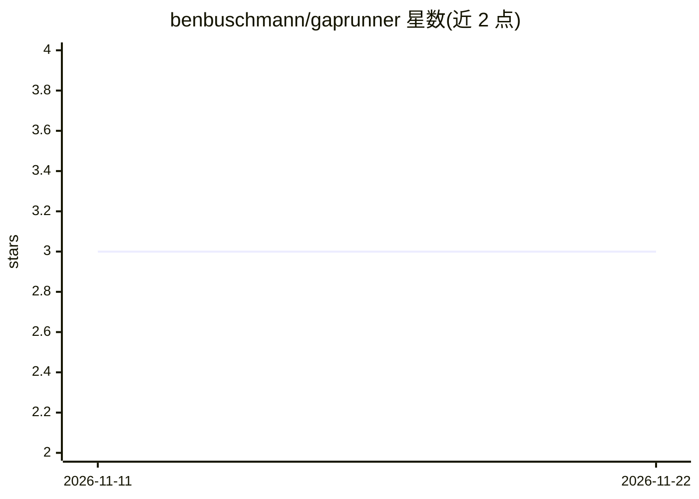

# benbuschmann/gaprunner

⭐ 3 · Python · Apache-2.0 · 推送 2026-11-21 · [GitHub](https://github.com/benbuschmann/gaprunner) · 个人维护

**为本地模型 GPU 编排训练/评测任务的队列**

面向自托管模型服务器的 GPU 任务队列，分两部分：带顺序、依赖、并发上限与健康检查的作业队列管理；以及利用模型空闲间隙的调度——请求到来时让任务让位（睡眠、冻结或停止），把 GPU 还给模型。通过 gate 代理与每秒决策的调度器实现，支持 vLLM/SGLang 睡眠模式、cuda-checkpoint 冻结进程等驱动。单 NVIDIA GPU 上运行，仅标准库的 Python 包，尚处 0.x 早期，未上 PyPI，从 GitHub 安装。

## 筛选速览

| 维度 | 判定 | 备注 |
|---|---|---|
| AI 角色 | `ai-ecosystem` | LLM/agent 周边工具 |
| 许可风险 | `permissive` | Apache-2.0 |
| 部署形态 | `library` | 以包/库形式分发 |
| 模型依赖 | local-ok | 支持本地模型 |
| 硬件要求 | — | 无带数字的原话,不猜 |
| 安装摩擦 | `medium` | 含编译或系统依赖之一 |
| 成熟度 | `idea` | |

## 能力要点

- gate 代理在模型睡眠时持有请求，唤醒后流式返回
- 任务可 beside/yield/no/window_only 四种放置方式与模型共享 GPU
- calibrate 命令实测每个任务占用的 GPU/CPU/磁盘内存
- 面向 coding agent 提供 agent 指南、skill 与 llms.txt

## 适用场景

- 一台 GPU 机器白天服务模型、夜里排队跑微调与评测
- 多个 agent 全天调用模型时安排剩余 GPU 资源的先后顺序
- 长任务与在线推理共存时防止内存争抢

## 场景标签

`模型评测` `微调` · 领域:评测与运维

## 证据(README 行号)

> L11: stalls, and get it out of the way when the model needs the GPU. GapRunner does that, in two parts:
> L21: It is one Python package (standard library only, Apache-2.0) that runs beside your model server on a single NVIDIA

## 星数曲线

2026-11-11 3 → 2026-11-22 3（+0）

---
*卡片 v1 · prompt 1.4 · 生成 2026-11-22 · 置信度 mid · 依据 README sha `adde3c0c1021` · [字段定义](../../DATASET.md)*
