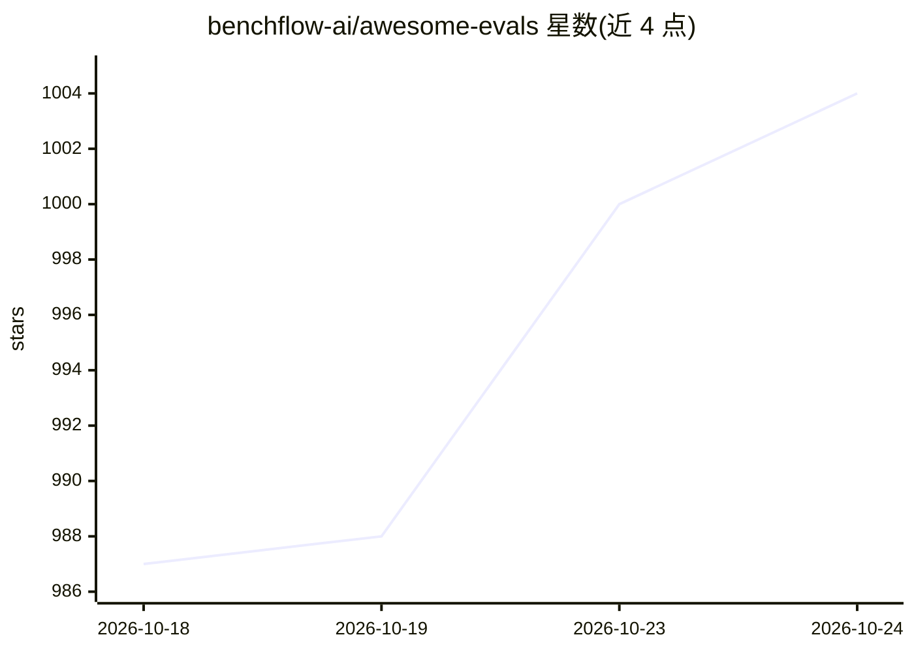

# benchflow-ai/awesome-evals

⭐ 1,004 · NOASSERTION · 推送 2026-10-21 · [GitHub](https://github.com/benchflow-ai/awesome-evals) · 组织维护

**面向 AI agent 评测与构建的资源策展清单，含论文/博客/工具/基准**

由 BenchFlow 维护的 agent 评测主题 awesome 清单：收录 443+ 条精选链接与 143 篇深度阅读笔记，覆盖论文、博客、演讲、课程、工具与基准。条目附注释说明其内容与收录理由，经深度引用爬取（11.6k 论文按入度排序）、从业者网络发现、47 场演讲转录与逐节缺口审计汇编而成，失效条目会被剔除。另附 PATTERNS.md 实践手册，含可运行代码示例（LLM-as-judge、pass@k、轨迹评分等）。限制：清单为资源导航，非可直接安装运行的工具。

## 筛选速览

| 维度 | 判定 | 备注 |
|---|---|---|
| AI 角色 | `ai-knowledge` | 知识聚合/清单类 |
| 许可风险 | `none` | NOASSERTION |
| 部署形态 | `self-host` | docker 或自建部署 |
| 模型依赖 | — | README 未给出锁定关系 |
| 硬件要求 | — | 无带数字的原话,不猜 |
| 安装摩擦 | `low` | 无编译、无系统依赖或容器化 |
| 成熟度 | — | 结构信号不足 |

## 能力要点

- 443+ 策展链接 + 143 篇深度阅读笔记
- 条目附注释说明收录理由，失效条目剔除并标注 ⚠ 警示
- PATTERNS.md 手册提供可运行代码与实例（LLM-as-judge、pass@k/pass^k、CI gating）
- 按主题分节组织（为何需要评测、评测⇄能力⇄RL 环境等）

## 适用场景

- 查找 agent 评测领域的论文、博客与基准资源
- 按必读入门清单快速进入 agent 评测领域
- 参考 PATTERNS.md 中的代码模式构建评测流程

## 场景标签

`模型评测` `精选清单` · 领域:评测与运维

## 证据(README 行号)

> L3: > A curated, opinionated, **non-BS** library of the best resources for **building and evaluating AI agents** — paper
> L14: **443+ curated links · 143 deep reading notes** (see `notes/`). Markers: 🆕 = released/updated 2025–2026 · ⚠️ = cave

## 星数曲线

2026-10-18 987 → 2026-10-24 1,004（+17）

---
*卡片 v1 · prompt 1.4 · 生成 2026-10-21 · 置信度 low · 依据 README sha `4bc3ee675f09` · [字段定义](../../DATASET.md)*
