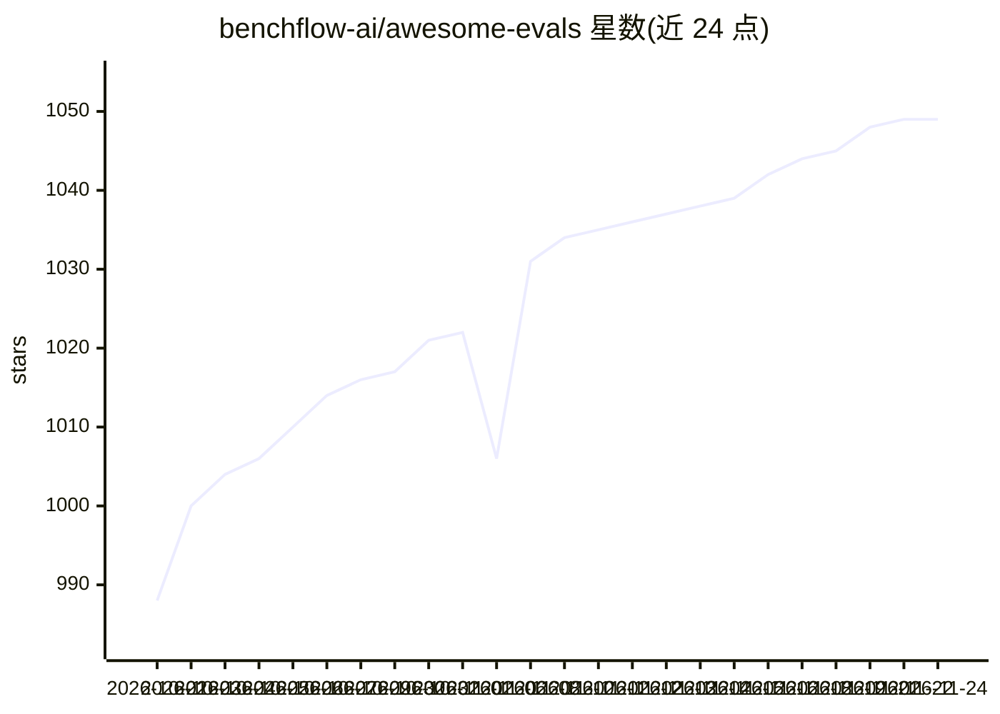

# benchflow-ai/awesome-evals

⭐ 1,049 · NOASSERTION · 推送 2026-11-04 · [GitHub](https://github.com/benchflow-ai/awesome-evals) · 组织维护

**AI agent 评测资源策展清单：面向构建与评估 agent 的开发者**

由 BenchFlow 维护的 agent 评测资源清单，收录 443+ 条链接与 143 篇深度阅读笔记，覆盖论文、博客、课程、工具与基准。收录流程包括深度为 4 的递归引文爬取（11.6k 篇论文按入度排序）、从业者网络来源检索、47 场演讲/播客的转录与笔记，以及分节缺口审计；每条条目带注解，URL 经核查，弃维护工具被剔除。另提供 PATTERNS.md 汇编 LLM-as-judge、pass@k 等可运行代码示例。

## 筛选速览

| 维度 | 判定 | 备注 |
|---|---|---|
| AI 角色 | `ai-knowledge` | 知识聚合/清单类 |
| 许可风险 | `none` | NOASSERTION |
| 部署形态 | `self-host` | docker 或自建部署 |
| 模型依赖 | — | README 未给出锁定关系 |
| 硬件要求 | — | 无带数字的原话,不猜 |
| 安装摩擦 | `low` | 无编译、无系统依赖或容器化 |
| 成熟度 | — | 结构信号不足 |

## 能力要点

- 443+ 条经注解与 URL 核查的策展链接，143 篇深度阅读笔记
- 基于 11.6k 篇论文的深度 4 递归引文爬取梳理学术脉络
- 47 场演讲与播客的逐字转录（含时间戳）
- PATTERNS.md 提供 LLM-as-judge、pass@k/pass^k 等可运行示例

## 适用场景

- 为 agent 评测方案查找论文、博客与基准资源
- 按清单入门学习 LLM/agent 评测方法
- 查找可运行的评测模式代码示例

## 场景标签

`精选清单` · 领域:学习与行业

## 证据(README 行号)

> L3: > A curated, opinionated, **non-BS** library of the best resources for **building and evaluating AI agents** — paper
> L14: **443+ curated links · 143 deep reading notes** (see `notes/`). Markers: 🆕 = released/updated 2025–2026 · ⚠️ = cave

## 星数曲线

2026-10-21 988 → 2026-11-24 1,049（+61）

---
*卡片 v1 · prompt 1.4 · 生成 2026-11-24 · 置信度 mid · 依据 README sha `6902b044e8fa` · [字段定义](../../DATASET.md)*
