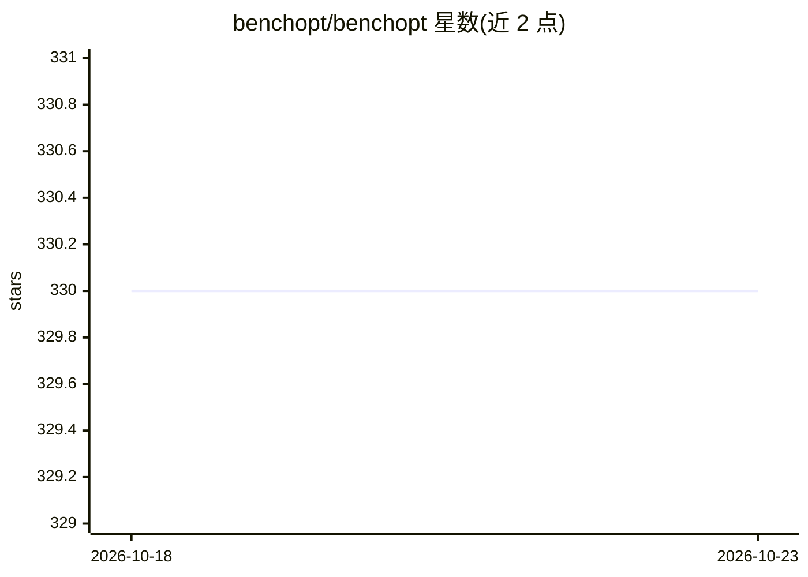

# benchopt/benchopt

⭐ 330 · Python · BSD-3-Clause · 推送 2026-10-20 · [GitHub](https://github.com/benchopt/benchopt) · [官网](https://benchopt.github.io) · 组织维护

**面向机器学习优化算法的可复现基准测试框架**

Benchopt 是用于机器学习与优化工作流的基准测试套件，目标是让基准可复现、可比较。框架用 Python 实现，但可运行以 Python、R、Julia 和 C/C++（命令行编译二进制）等多种语言编写的求解器，conda 可装的程序亦兼容。用户可复制/扩展现有基准（官方列出 LASSO、Elastic Net、Logistic 回归、ResNet 分类等 20 余个），或基于社区模板创建新基准；通过 CLI 一条命令安装求解器并运行，产出结果图表。有 NeurIPS 2022 论文，提供 bibtex 引用。

## 筛选速览

| 维度 | 判定 | 备注 |
|---|---|---|
| AI 角色 | `ai-ecosystem` | LLM/agent 周边工具 |
| 许可风险 | `permissive` | BSD-3-Clause |
| 部署形态 | `library` | 以包/库形式分发 |
| 模型依赖 | — | README 未给出锁定关系 |
| 硬件要求 | — | 无带数字的原话,不猜 |
| 安装摩擦 | `low` | 无编译、无系统依赖或容器化 |
| 成熟度 | — | 结构信号不足 |

## 能力要点

- 支持 Python/R/Julia/C++ 多语言求解器的统一基准运行
- CLI 自动安装求解器并运行基准（benchopt install/run）
- 官方维护 20 余个优化与 ML 基准仓库及结果页
- 社区提供基准模板，可自定义数据集、求解器与指标

## 适用场景

- 复现或扩展现有 ML 优化基准（如 LASSO、Logistic 回归）
- 为自己的优化算法构建可复现、可比较的基准
- 在科研论文中系统对比多个求解器的性能

## 场景标签

`模型评测` `科研工具` · 领域:评测与运维

## 证据(README 行号)

> L9: ``Benchopt`` is a benchmarking suite tailored for machine learning workflows.
> L67:  benchopt install . -s lightning -s sklearn
> L73:  benchopt run . --config ./example_config.yml

## 星数曲线

2026-10-18 330 → 2026-10-23 330（+0）

---
*卡片 v1 · prompt 1.4 · 生成 2026-10-21 · 置信度 high · 依据 README sha `274039422396` · [字段定义](../../DATASET.md)*
