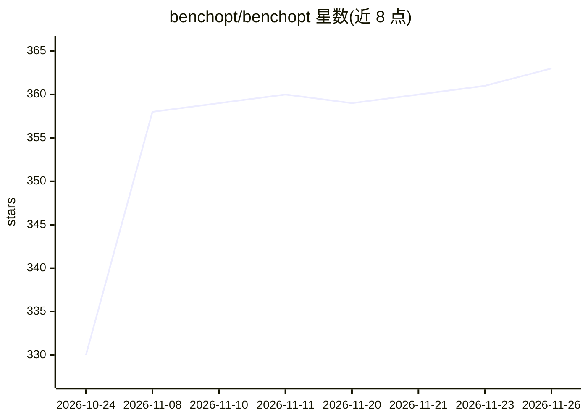

# benchopt/benchopt

⭐ 363 · Python · BSD-3-Clause · 推送 2026-11-23 · [GitHub](https://github.com/benchopt/benchopt) · [官网](https://benchopt.github.io) · 组织维护

**面向 ML 工作流的可复现基准测试框架**

Benchopt 是一个针对机器学习工作流的基准测试套件，以 Python 实现并可运行多种语言编写的算法（已测试 Python、R、Julia 及带命令行接口的 C/C++ 编译产物）。用户可通过 CLI 克隆并复现社区维护的既有基准（如 L2 逻辑回归），或基于官方模板创建自己的基准；基准由数据集、求解器、指标组成，可按需安装求解器后运行并生成结果图表。主要面向科研与工程场景中需要可复现、可比较基准的用户。

## 筛选速览

| 维度 | 判定 | 备注 |
|---|---|---|
| AI 角色 | `ai-ecosystem` | LLM/agent 周边工具 |
| 许可风险 | `permissive` | BSD-3-Clause |
| 部署形态 | `library` | 以包/库形式分发 |
| 模型依赖 | — | README 未给出锁定关系 |
| 硬件要求 | — | 无带数字的原话,不猜 |
| 安装摩擦 | `low` | 无编译、无系统依赖或容器化 |
| 成熟度 | — | 结构信号不足 |

## 能力要点

- Python 实现，支持运行 Python/R/Julia/C++ 等多语言算法
- CLI 一键克隆并复现既有基准（benchopt install / benchopt run）
- 提供基准模板与教程供创建自定义基准
- 维护 20 个左右官方基准仓库并发布结果页面

## 适用场景

- 复现论文中已有的优化/ML 基准结果
- 为自己的求解器做可比较的性能评测
- 基于模板搭建团队内部基准

## 场景标签

`模型评测` `科研工具` · 领域:评测与运维

## 证据(README 行号)

> L9: ``Benchopt`` is a benchmarking suite tailored for machine learning workflows.
> L69: 3. Run the benchmark to get the figure below
> L73:  benchopt run . --config ./example_config.yml

## 星数曲线

2026-10-24 330 → 2026-11-26 363（+33）

---
*卡片 v1 · prompt 1.4 · 生成 2026-11-25 · 置信度 high · 依据 README sha `c83671765068` · [字段定义](../../DATASET.md)*
