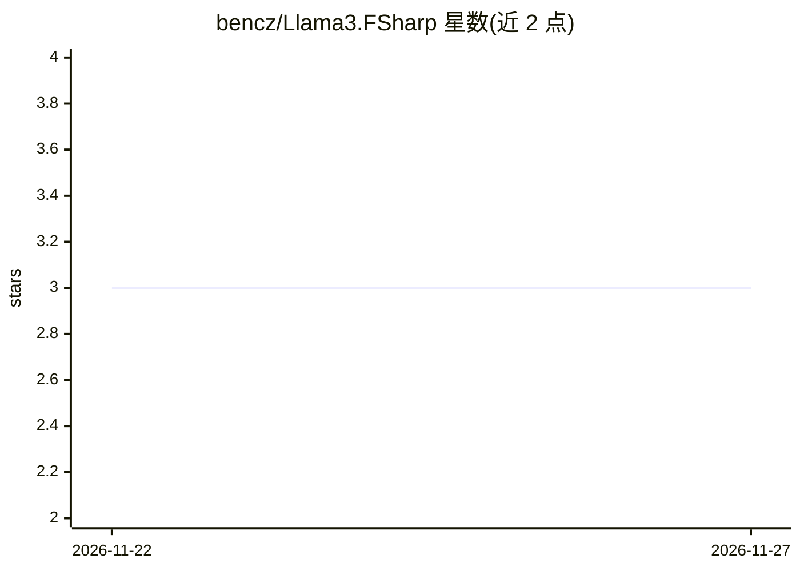

# bencz/Llama3.FSharp

⭐ 3 · F# · MIT · 推送 2026-11-26 · [GitHub](https://github.com/bencz/Llama3.FSharp) · 个人维护

**给开发者的 Llama/Qwen 本地推理运行时（F#，CPU/GPU/混合）**

F# 编写的 Llama/Qwen 推理运行时，起源于 likejazz/llama3.cuda 的移植。同一份 transformer 实现运行在 CPU、CUDA GPU 或两者混合模式，提供显存规划、逐层算子放置与多 GPU 流水线。读取 GGUF（含 llama.cpp 分片）与 llama2.c 检查点，支持 F32 至 Q4_K/Q6_K 多种量化格式及 Qwen3 MoE。GPU 内核由 ILGPU 运行时编译为 PTX，仅依赖 NVIDIA 驱动，无需 CUDA Toolkit。以 CLI 与 F# 库两种形式提供，dotnet 构建。

## 筛选速览

| 维度 | 判定 | 备注 |
|---|---|---|
| AI 角色 | `ai-ecosystem` | LLM/agent 周边工具 |
| 许可风险 | `permissive` | MIT |
| 部署形态 | `None` |  |
| 模型依赖 | — | README 未给出锁定关系 |
| 硬件要求 | — | 无带数字的原话,不猜 |
| 安装摩擦 | `high` | 编译与系统依赖俱全 |
| 成熟度 | — | 结构信号不足 |

## 能力要点

- CPU/GPU/混合三种执行模式，逐层放置与任意数量 GPU 流水线
- GGUF 内存映射加载，支持 llama.cpp 分片与多格式量化（Q8_0/Q4_0/Q4_K/Q6_K 等）
- ILGPU 运行时编译 PTX，仅需 NVIDIA 驱动，无需 CUDA Toolkit/nvcc/cuBLAS
- 215 项数值验证测试，与独立 float64 参考实现及 llama3.cu 输出比对

## 适用场景

- 在本地 CPU 或 NVIDIA GPU 上运行 Llama/Qwen 量化模型做文本生成
- 显存不足时把模型部分层卸载到 CPU 的混合推理
- 多 GPU 环境下按显存比例切分大模型（如 18.5GB MoE）
- 在 .NET/F# 项目中作为推理库集成

## 场景标签

`推理引擎` · 领域:训练与推理

## 证据(README 行号)

> L3: Inference runtime for Llama/Qwen in F#, which started as a port of likejazz/llama3.cuda (`llama3.cu`).
> L4: A single implementation of the transformer runs on **CPU**, **GPU (CUDA)** or **both (hybrid)**, with GPU memory pla
> L7: - **GPU:** kernels written in F# and compiled to PTX at runtime by ILGPU. Only the **NVIDIA driver** is needed: no C

## 星数曲线

2026-11-22 3 → 2026-11-27 3（+0）

---
*卡片 v1 · prompt 1.4 · 生成 2026-11-22 · 置信度 high · 依据 README sha `dafb6d8f1de2` · [字段定义](../../DATASET.md)*
