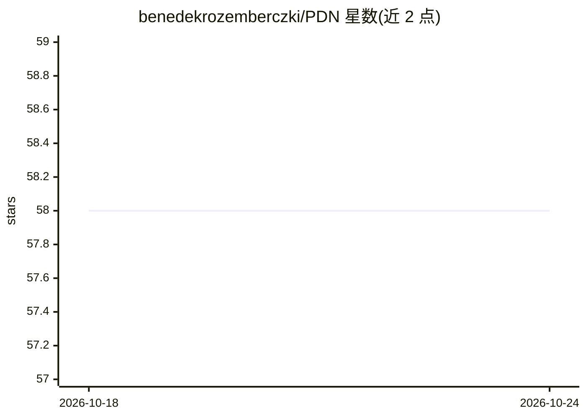

# benedekrozemberczki/PDN

⭐ 58 · Python · GPL-3.0 · 推送 2025-12-28 · [GitHub](https://github.com/benedekrozemberczki/PDN) · [官网](https://arxiv.org/abs/2010.12878) · 个人维护

**WebConf'21 PDN 图神经网络的 PyTorch 官方实现**

论文《Pathfinder Discovery Networks for Neural Message Passing》（WebConf 2021）的官方 PyTorch 实现。PDN 在多重网络上联合学习消息传递图与下游半监督模型，为每条边归纳学习聚合权重，是图注意力机制的泛化，支持边卷积与多尺度混合层，面向节点分类任务。仓库提供 src/main.py 训练脚本，通过命令行参数指定边表、节点/边特征与超参，输入为 NumPy 数组，在测试集上输出预测评分。Python 3.8.5 开发，许可证为 GNU。

## 筛选速览

| 维度 | 判定 | 备注 |
|---|---|---|
| AI 角色 | `ai-native` | 本体是模型或模型工具 |
| 许可风险 | `viral` | GPL-3.0 |
| 部署形态 | `None` |  |
| 模型依赖 | — | README 未给出锁定关系 |
| 硬件要求 | — | 无带数字的原话,不猜 |
| 安装摩擦 | `low` | 无编译、无系统依赖或容器化 |
| 成熟度 | — | 结构信号不足 |

## 能力要点

- 在多重网络上联合学习消息传递图与下游半监督模型
- 逐边归纳学习聚合权重，泛化图注意力机制
- 提供命令行训练脚本，输入为 NumPy 数组边表与特征

## 适用场景

- 复现论文中的 PDN 节点分类实验
- 在自定义多重图数据上训练 PDN 模型
- 研究图注意力机制的可解释信息传播

## 场景标签

 · 领域:图机器学习/科研代码

## 证据(README 行号)

> L6:  A **PyTorch** implementation of **"Pathfinder Discovery Networks for Neural Message Passing"** (WebConf 2021).
> L10: In this work we propose Pathfinder Discovery Networks (PDNs), a method for jointly learning a message passing graph

## 星数曲线

2026-10-18 58 → 2026-10-24 58（+0）

---
*卡片 v1 · prompt 1.4 · 生成 2026-10-24 · 置信度 high · 依据 README sha `923296a379d8` · [字段定义](../../DATASET.md)*
