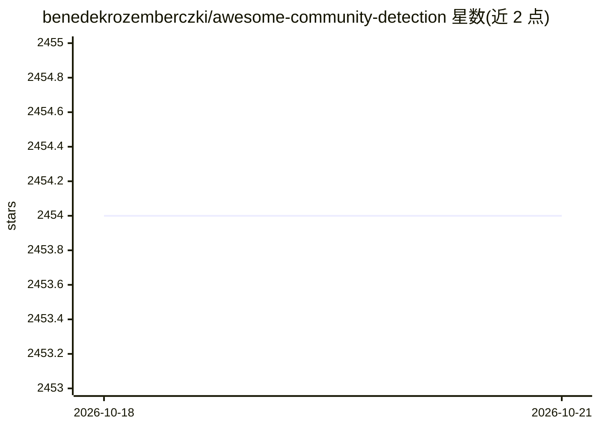

# benedekrozemberczki/awesome-community-detection

⭐ 2,454 · Python · CC0-1.0 · 推送 2025-12-20 · [GitHub](https://github.com/benedekrozemberczki/awesome-community-detection) · 个人维护

**社区发现研究论文及实现的策展清单**

由个人维护的社区发现（community detection）研究论文集合：按主题（如深度学习、嵌入、分解、图聚类等方向）组织论文条目并附实现代码链接。面向图挖掘与数据科学方向的研究者和开发者，用于检索领域文献与对应开源实现。README 同时提及维护者的其他相关论文集合（图分类、决策树、欺诈检测、梯度提升等）。仓库接受 PR 贡献，附带许可证信息。

## 筛选速览

| 维度 | 判定 | 备注 |
|---|---|---|
| AI 角色 | `ai-knowledge` | 知识聚合/清单类 |
| 许可风险 | `viral` | CC0-1.0 |
| 部署形态 | `None` |  |
| 模型依赖 | — | README 未给出锁定关系 |
| 硬件要求 | — | 无带数字的原话,不猜 |
| 安装摩擦 | `low` | 无编译、无系统依赖或容器化 |
| 成熟度 | — | 结构信号不足 |

## 能力要点

- 社区检测研究论文条目附实现链接
- 按主题目录组织（深度学习、嵌入、分解等方向）
- 接受 PR 贡献，由 benedekrozemberczki 维护

## 适用场景

- 查找社区发现方向的研究论文与开源实现
- 了解图聚类、图嵌入相关方法的文献分布

## 场景标签

`精选清单` · 领域:学习与行业

## 证据(README 行号)

> L7: A collection of community detection research papers.
> L9: Similar collections about graph classification, classification/regression tree, fraud detection, and gradient boosti

## 星数曲线

2026-10-18 2,454 → 2026-10-21 2,454（+0）

---
*卡片 v1 · prompt 1.4 · 生成 2026-10-21 · 置信度 high · 依据 README sha `8c4cd2c1361e` · [字段定义](../../DATASET.md)*
