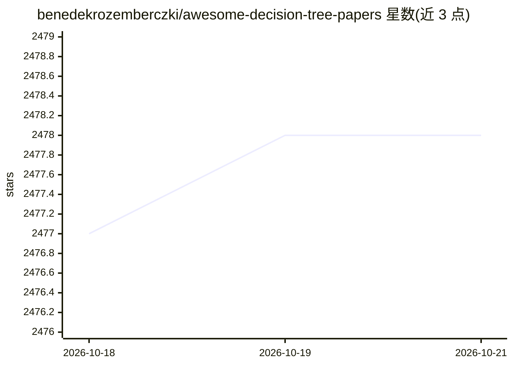

# benedekrozemberczki/awesome-decision-tree-papers

⭐ 2,478 · Python · CC0-1.0 · 推送 2025-12-28 · [GitHub](https://github.com/benedekrozemberczki/awesome-decision-tree-papers) · 个人维护

**决策/分类/回归树研究论文策展清单，附实现链接**

由个人维护的决策树、分类树与回归树方向研究论文精选清单：按年份（2020-2022）与会议（NeurIPS/ICML/ICLR/AAAI/KDD/ACL 等）组织条目，每条含论文标题、作者、论文链接，部分条目附代码仓库或 PyPI 包链接。主题覆盖最优决策树优化、树集成解释与反事实、鲁棒性、公平性、联邦梯度提升树等。清单本身不含可运行代码，仅供文献检索参考。

## 筛选速览

| 维度 | 判定 | 备注 |
|---|---|---|
| AI 角色 | `ai-knowledge` | 知识聚合/清单类 |
| 许可风险 | `viral` | CC0-1.0 |
| 部署形态 | `library` | 以包/库形式分发 |
| 模型依赖 | — | README 未给出锁定关系 |
| 硬件要求 | — | 无带数字的原话,不猜 |
| 安装摩擦 | `low` | 无编译、无系统依赖或容器化 |
| 成熟度 | — | 结构信号不足 |

## 能力要点

- 按会议与年份组织的论文条目，含作者与论文链接
- 部分条目附第三方代码仓库或 PyPI 包链接
- 覆盖最优树学习、树集成解释、鲁棒性、公平性等子方向

## 适用场景

- 查找决策树与树集成方向的顶会论文
- 顺论文条目定位可用的开源实现
- 按年份追踪该领域研究脉络

## 场景标签

`精选清单` · 领域:学习与行业

## 证据(README 行号)

> L7: A curated list of classification and regression tree research papers with implementations from the following confere
> L42: - **Using MaxSAT for Efficient Explanations of Tree Ensembles (AAAI 2022)**

## 星数曲线

2026-10-18 2,477 → 2026-10-21 2,478（+1）

---
*卡片 v1 · prompt 1.4 · 生成 2026-10-21 · 置信度 mid · 依据 README sha `a9581e76579b` · [字段定义](../../DATASET.md)*
