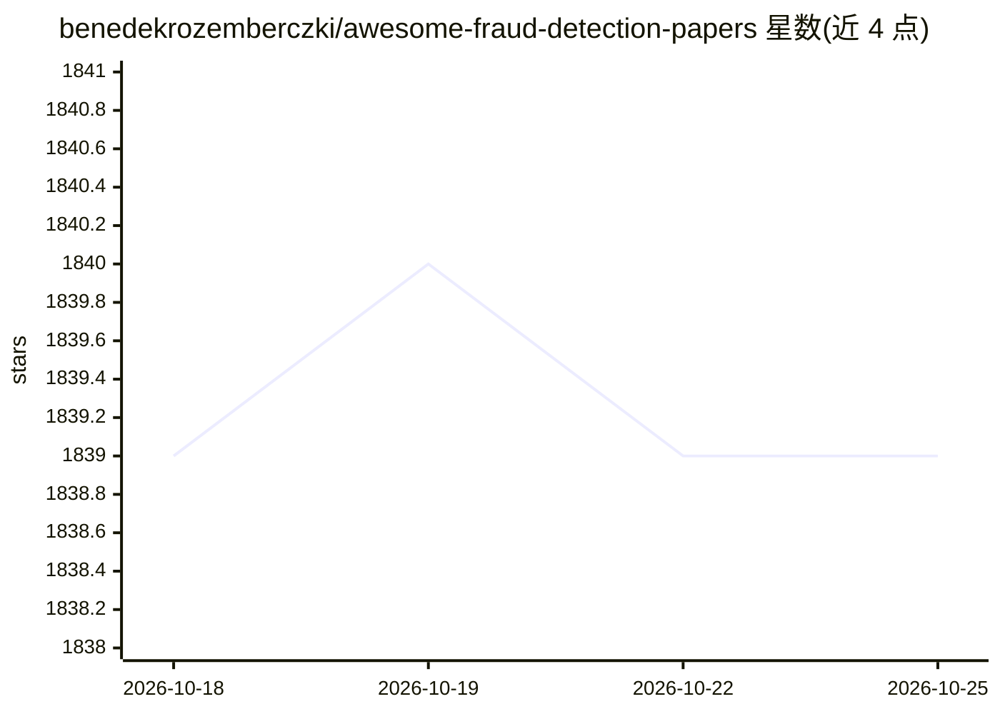

# benedekrozemberczki/awesome-fraud-detection-papers

⭐ 1,839 · Python · CC0-1.0 · 推送 2026-01-05 · [GitHub](https://github.com/benedekrozemberczki/awesome-fraud-detection-papers) · 个人维护

**欺诈检测研究论文策展清单（2022–2025，多会议）**

由 benedekrozemberczki 维护的欺诈检测论文聚合清单：收录来自 KDD、AAAI、IJCAI、WWW、CIKM、ICDM、AISTATS、TKDE、ICLR、ICML、WSDM 等数据挖掘与 AI 会议的欺诈检测论文，按年份（2022–2025）组织，每条含论文标题、会议名、作者列表与论文链接，部分条目附代码仓库链接。主题覆盖图神经网络欺诈检测、信用卡欺诈、保险欺诈、反洗钱、区块链/以太坊欺诈检测等。README 同时列举同作者维护的图分类、梯度提升、蒙特卡洛树搜索、社区检测等姊妹论文清单。纯文献目录，无可安装组件。

## 筛选速览

| 维度 | 判定 | 备注 |
|---|---|---|
| AI 角色 | `ai-knowledge` | 知识聚合/清单类 |
| 许可风险 | `viral` | CC0-1.0 |
| 部署形态 | `None` |  |
| 模型依赖 | — | README 未给出锁定关系 |
| 硬件要求 | — | 无带数字的原话,不猜 |
| 安装摩擦 | `low` | 无编译、无系统依赖或容器化 |
| 成熟度 | — | 结构信号不足 |

## 能力要点

- 按年份组织 2022–2025 欺诈检测论文条目
- 条目含会议、作者与论文链接，部分附代码链接
- 覆盖图神经网络、信用卡、保险、区块链等多类欺诈检测主题

## 适用场景

- 查找欺诈检测方向的顶会论文与开源实现
- 跟踪 2022–2025 年欺诈检测研究进展
- 调研图学习方法在金融风控中的应用

## 场景标签

`精选清单` `金融量化` · 领域:学习与行业

## 证据(README 行号)

> L7: A curated list of fraud detection papers from the following conferences:
> L33: ## 2025

## 星数曲线

2026-10-18 1,839 → 2026-10-25 1,839（+0）

---
*卡片 v1 · prompt 1.4 · 生成 2026-10-21 · 置信度 high · 依据 README sha `00f707a5e6d6` · [字段定义](../../DATASET.md)*
