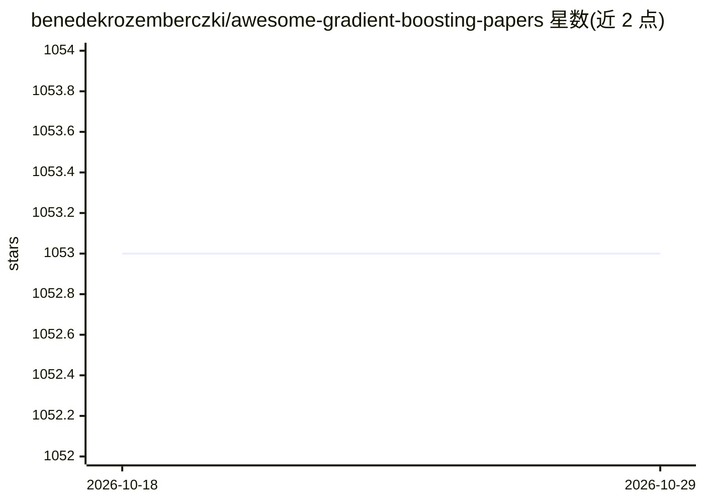

# benedekrozemberczki/awesome-gradient-boosting-papers

⭐ 1,053 · Python · CC0-1.0 · 推送 2026-01-05 · [GitHub](https://github.com/benedekrozemberczki/awesome-gradient-boosting-papers) · 个人维护

**梯度提升研究论文策展清单，按会议与年份组织并附代码链接**

由 benedekrozemberczki 维护的梯度提升与自适应提升（AdaBoost）研究论文策展清单，收录范围限定为 NeurIPS、ICML、ICLR、AAAI、KDD、CVPR、ACL 等约 27 个机器学习、计算机视觉、自然语言处理、数据挖掘与人工智能会议。条目按年份（2020-2025）分组，每条含论文标题、会议、作者列表，部分条目附 arXiv 或 ACM 论文链接及 GitHub 代码仓库链接。README 同时链接同一维护者的图分类、决策树、欺诈检测等相关论文集合。清单本身不含可安装的软件。

## 筛选速览

| 维度 | 判定 | 备注 |
|---|---|---|
| AI 角色 | `ai-knowledge` | 知识聚合/清单类 |
| 许可风险 | `viral` | CC0-1.0 |
| 部署形态 | `None` |  |
| 模型依赖 | — | README 未给出锁定关系 |
| 硬件要求 | — | 无带数字的原话,不猜 |
| 安装摩擦 | `low` | 无编译、无系统依赖或容器化 |
| 成熟度 | — | 结构信号不足 |

## 能力要点

- 覆盖约 27 个 ML/CV/NLP/数据挖掘/AI 会议的论文条目
- 按年份 2020-2025 分组组织
- 部分论文附 GitHub 实现代码链接

## 适用场景

- 查找梯度提升方向的会议论文及对应开源实现
- 按年份跟踪梯度提升研究进展
- 了解同一维护者的相关论文集合网络

## 场景标签

`精选清单` · 领域:学习与行业

## 证据(README 行号)

> L1: # Awesome Gradient Boosting Research Papers
> L4: A curated list of gradient and adaptive boosting papers with implementations from the following conferences:

## 星数曲线

2026-10-18 1,053 → 2026-10-29 1,053（+0）

---
*卡片 v1 · prompt 1.4 · 生成 2026-10-21 · 置信度 high · 依据 README sha `0d57f9a9aeea` · [字段定义](../../DATASET.md)*
