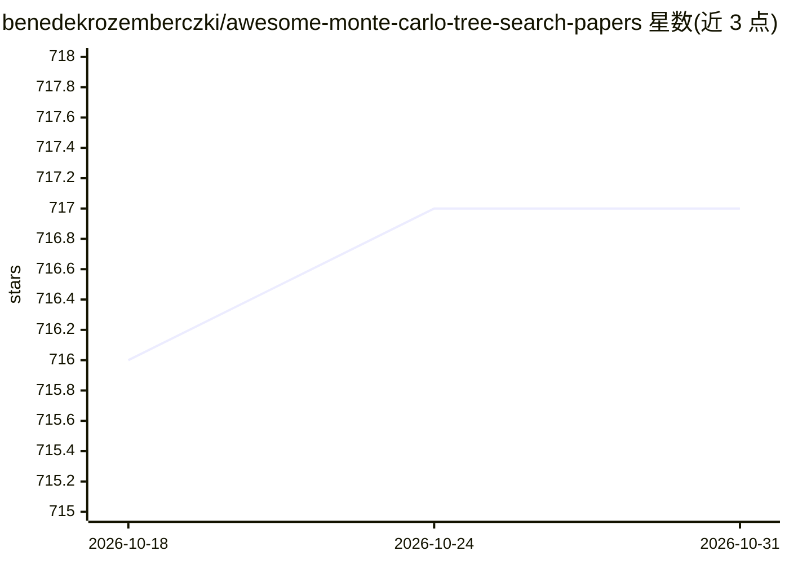

# benedekrozemberczki/awesome-monte-carlo-tree-search-papers

⭐ 717 · Python · CC0-1.0 · 推送 2026-01-13 · [GitHub](https://github.com/benedekrozemberczki/awesome-monte-carlo-tree-search-papers) · 个人维护

**蒙特卡洛树搜索论文策展清单：按会议与年份收录论文及实现**

由个人维护的 Monte Carlo Tree Search（MCTS）论文策展清单，收录范围限定为 NeurIPS、ICML、CVPR、AAAI、IJCAI、UAI 等机器学习、计算机视觉、NLP、数据挖掘、AI、机器人与游戏领域的会议/期刊论文。条目按年份（2022-2025）倒序组织，每条包含作者与 Paper/Code 链接；近年条目覆盖 LLM 推理、定理证明、代码生成、知识图谱问答等 MCTS 与大模型结合方向。列表本身不提供可安装运行的软件。

## 筛选速览

| 维度 | 判定 | 备注 |
|---|---|---|
| AI 角色 | `ai-knowledge` | 知识聚合/清单类 |
| 许可风险 | `viral` | CC0-1.0 |
| 部署形态 | `None` |  |
| 模型依赖 | — | README 未给出锁定关系 |
| 硬件要求 | — | 无带数字的原话,不猜 |
| 安装摩擦 | `low` | 无编译、无系统依赖或容器化 |
| 成熟度 | — | 结构信号不足 |

## 能力要点

- 按 2022-2025 年份与会议组织的 MCTS 论文条目
- 每条含作者与 Paper/Code 链接
- 覆盖 MCTS 与 LLM 推理/定理证明/代码生成结合的近期论文

## 适用场景

- 查找 MCTS 领域各顶会论文及对应开源实现
- 调研 MCTS 在 LLM 推理与决策方向的应用进展
- 按年份追溯 MCTS 研究脉络

## 场景标签

`精选清单` · 领域:学习与行业

## 证据(README 行号)

> L4: A curated list of Monte Carlo tree search papers with implementations from the following conferences/journals:
> L28: ## 2025

## 星数曲线

2026-10-18 716 → 2026-10-31 717（+1）

---
*卡片 v1 · prompt 1.4 · 生成 2026-10-21 · 置信度 high · 依据 README sha `a995628d611e` · [字段定义](../../DATASET.md)*
