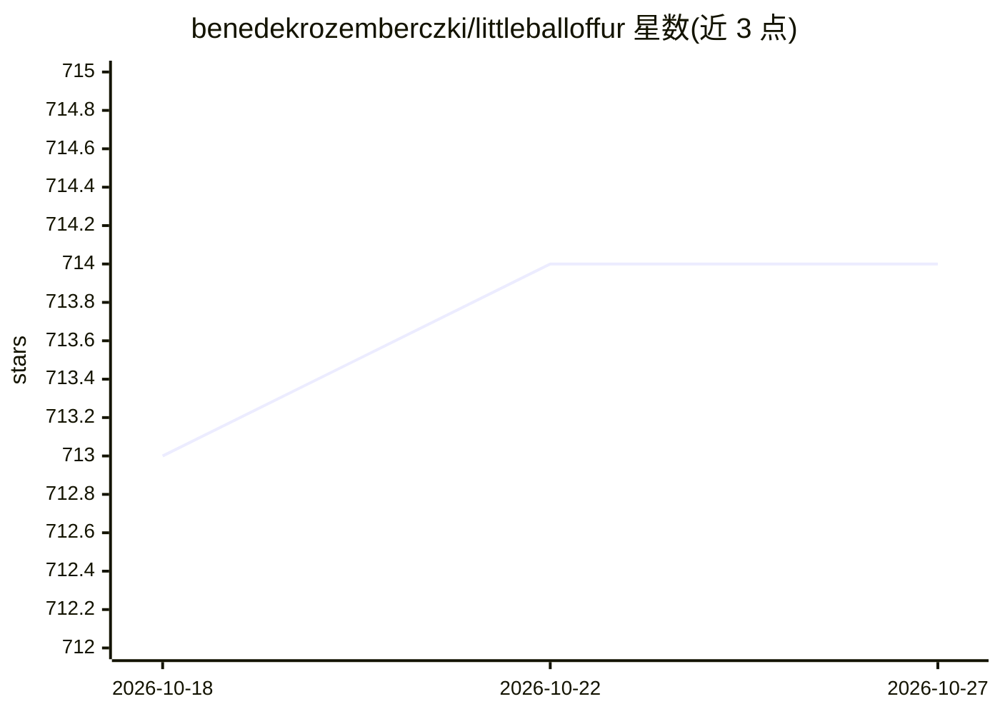

# benedekrozemberczki/littleballoffur

⭐ 714 · Python · GPL-3.0 · 推送 2025-12-20 · [GitHub](https://github.com/benedekrozemberczki/littleballoffur) · [官网](https://little-ball-of-fur.readthedocs.io) · 个人维护

**给开发者的 Python 图采样算法库**

Python 图采样扩展库，为 NetworkX/NetworKit 等图数据提供顶点、边与探索式采样方法，含 Degree Based、PageRank、Snowball、Forest Fire、Metropolis Hastings、Spiky Ball 等 30 余种采样器，均来自 Networking、KDD、ICDE 等会议与期刊论文，并提供统一公开接口便于终端用户调用。通过 pip 安装，附示例脚本与测试，采用 GPLv3 许可证，配套 CIKM 2020 论文与文档。

## 筛选速览

| 维度 | 判定 | 备注 |
|---|---|---|
| AI 角色 | `ai-ecosystem` | LLM/agent 周边工具 |
| 许可风险 | `viral` | GPL-3.0 |
| 部署形态 | `library` | 以包/库形式分发 |
| 模型依赖 | — | README 未给出锁定关系 |
| 硬件要求 | — | 无带数字的原话,不猜 |
| 安装摩擦 | `low` | 无编译、无系统依赖或容器化 |
| 成熟度 | — | 结构信号不足 |

## 能力要点

- 覆盖顶点、边、探索式三类共 30 余种图采样算法
- 统一公开接口，简化采样算法的调用
- 方法源自 Networking/KDD/ICDE 等会议期刊论文
- 提供示例脚本与 pip 安装

## 适用场景

- 在大型图数据上抽取可分析的子图
- 图嵌入或图机器学习前的图稀疏化预处理
- 对比不同图采样算法的效果

## 场景标签

 · 领域:图数据挖掘/网络分析

## 证据(README 行号)

> L3: **Little Ball of Fur** is a graph sampling extension library for Python.
> L7: **Little Ball of Fur** consists of methods that can sample from graph structured data. To put it simply it is a Swis

## 星数曲线

2026-10-18 713 → 2026-10-27 714（+1）

---
*卡片 v1 · prompt 1.4 · 生成 2026-10-21 · 置信度 high · 依据 README sha `bc3cce2ce02e` · [字段定义](../../DATASET.md)*
